<h1>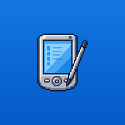 PocketStylus</h1>

**Native Pocket PC and Windows Mobile hypervisor for Android.**

PocketStylus boots the original, unmodified Windows Mobile ROM images that Microsoft shipped for its Device Emulator: Windows Mobile 2003 Second Edition, 5.0, 6.1.4, 6.5 and 6.5.3. It runs them full-screen on a modern Android phone, and your phone becomes the Windows Mobile device. On Windows Mobile 5 and later, its battery, signal, carrier, Wi-Fi, GPS, camera, speaker, vibration motor, clipboard, keyboard, wallpaper, colour theme and phone line all show up inside Windows Mobile as that device's own hardware. 2003 Second Edition Pocket PC runs the helper on .NET Compact Framework 2.0, which autorun installs on first boot. Clipboard, keyboard and backlight use the same commands as later releases, and theme and wallpaper go through that shell's Today picture and system colours. Calls, texts and contact sync are not offered: this image does not have the later phone libraries. The Smartphone image's shell does not run the storage-card autorun, so that release stays without the helper.

It was built and tuned on a Galaxy Z Fold7. On a foldable, opening the phone turns it into an Xperia X1-style slider with a landscape screen above a hardware keyboard.

### Download

| | Latest release |
|---|---|
| GitHub | [**PocketStylus.apk**](https://github.com/UiharuKazari2008/StylusPPC/releases/latest/download/PocketStylus.apk) · [release notes](https://github.com/UiharuKazari2008/StylusPPC/releases/latest) |
| yozora | [**PocketStylus.apk.zip**](https://yozora.bluesteel.737.jp.net/UiharuKazari2008/StylusPPC/releases/download/latest/PocketStylus.apk.zip) (the APK, zipped) · [release notes](https://yozora.bluesteel.737.jp.net/UiharuKazari2008/StylusPPC/releases/latest) |

These links always point to the newest release. Android 8.0 or newer, ARM64.

### Screenshots

<p align="center">
  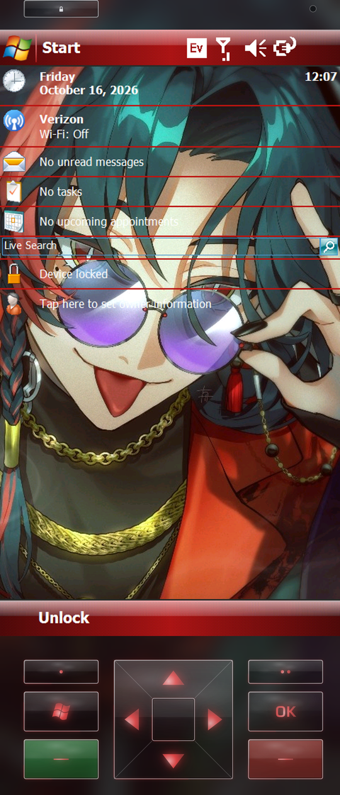
  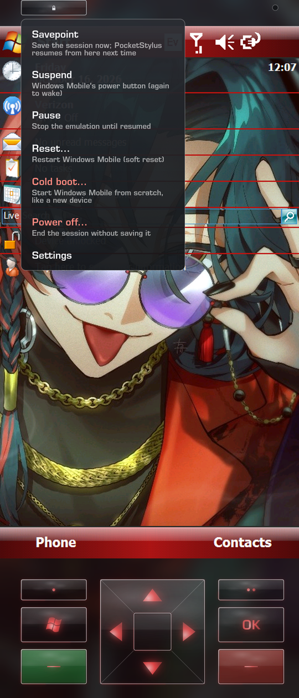
</p>
<p align="center">
  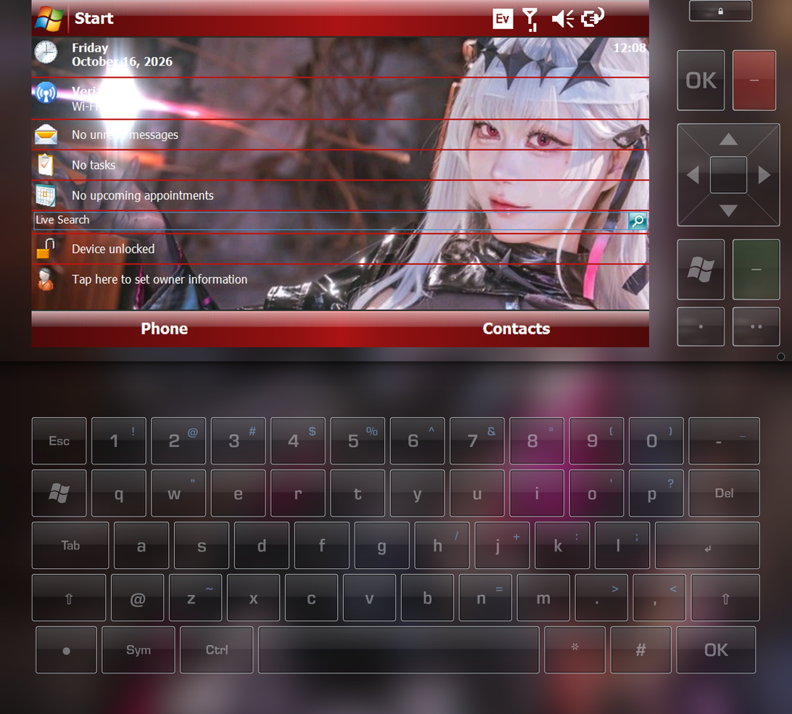
</p>

| WM 6.5.3 | | | WM 6.1.4 | | WM 5.0 | |
|---|---|---|---|---|---|---|
| 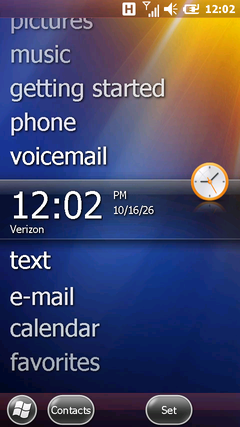 | 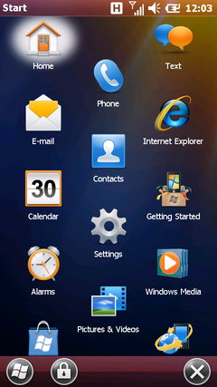 | 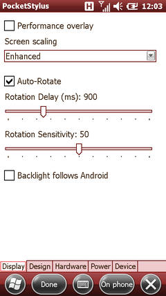 | 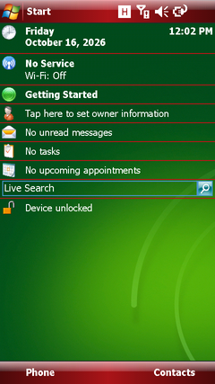 | 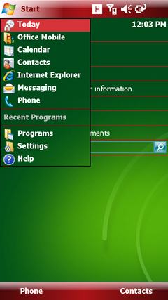 | 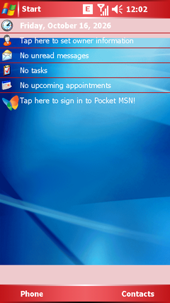 | 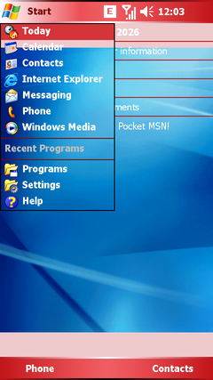 |
| Titanium home | Start menu | PocketStylus settings | Today | Start menu | Today | Start menu |

All three releases above use the phone's Material You colour as their Windows Mobile theme and show the phone's carrier and data type. The phone wallpaper is synced into Windows Mobile too.

---

## Why this is an accomplishment

Microsoft's Device Emulator (DE) was a Windows-only x86 program, and it was never ported. Running its images anywhere else means rebuilding, from nothing, the whole machine those ROMs expect to wake up on:

- **A full ARM computer, written from scratch.** DE emulates a Samsung SMDK2410 development board: an ARM920T-class CPU, the S3C2410 system-on-chip (interrupt controller, timers, DMA, LCD, touch ADC, UARTs, GPIO, RTC, sleep logic), AMD CFI NOR flash, a PCMCIA bridge with an NE2000 network card, and a set of DE-only devices for battery, LEDs, audio and folder sharing. PocketStylus re-implements every one of them in portable C++ (about 11,000 lines in `core/` and the native app layer). Each register was rebuilt from documentation and from observing the guest. DE's own source code is under an academic, Windows-only licence, so not one line of it is used (see `docs/research-de-hardware.md`).
- **A CPU fast enough to be pleasant.** A naive ARMv5TE interpreter gave about 21 MIPS; Windows Mobile 6.5 needs far more to feel like a phone. The core has an ARM64 JIT with a software TLB, block chaining and inlined fast paths. It runs at 380–420 MIPS under load and peaks around 800. A lockstep `--compare` mode checks it against the interpreter instruction by instruction. Cold boot to the home screen takes about 30 seconds. Resuming a saved session takes under one second.
- **A phone battery is not a desktop PC.** Windows Mobile ticks its scheduler 1,000 times a second, and an emulator that faithfully wakes 1,000 times a second keeps a phone's CPU from ever sleeping. When Windows Mobile is halted, PocketStylus batches that tick into the 16 ms frame and replays the owed ticks, so a quiet screen does not wake the phone a thousand times a second. It presents only the screen rows that changed, reports real work to Android's performance hints, and steps down when nothing happens.
- **An operating system that never knew Android existed.** To make Windows Mobile believe the phone's hardware is its own, PocketStylus runs a small agent inside the guest: a .NET Compact Framework 3.5 helper, plus a hand-built native ARM bootstrap that installs .NET CF 3.5 silently on releases that lack it. The agent and the app talk through a sideband in the emulated machine and a TCP link on the virtual network. The storage-card mailbox remains for the helper while it is starting. To make everything feel native, the project had to reverse-engineer undocumented Windows Mobile behaviour:
  - how the title bar picks the G / E / 3G / H / 1X / Ev icon;
  - how Titanium caches wallpapers;
  - how the WM 5 colour engine recolours the shell;
  - why the lock screen smeared after 25 wallpaper changes;
  - how FakeRIL's dial thread can be held open until a real Android call connects.

  Some fixes needed in-memory patches of Microsoft's own ROM drivers, and one needed a hand-assembled ARM DLL that Windows Mobile loads as its camera driver.
- **Modern-phone niceties on a 2009 OS.** These include Material You colours applied as a native Windows Mobile theme, foldable layouts, phone-shaped screen resolutions the OS was never shipped with, live rotation, snapshot and resume, a gyroscope-driven glass skin, and outgoing calls placed from Windows Mobile's own dialer.

Every feature below was verified by booting real ROMs, both in the app and in a headless runner on the phone (`core/cli`).

---

## Supported Windows Mobile releases

| Release | Image needed | Notes |
|---|---|---|
| **Windows Mobile 6.5.3 Professional** | `PPC_USA_GSM_FWVGA_VR.BIN` (optional: `PPC_USA_GSM_WVGA_VR.BIN`) | Main target. Titanium home screen, FakeRIL radio, everything below works. The optional WVGA image is what 480×800 boots, so the Start button does not stick and HTC games fit. |
| **Windows Mobile 6.5 Professional** | `PPC_USA_GSM_WVGA_VR.BIN` (optional: VGA, WQVGA, square, QVGA) | Original 6.5 (build 5.2.21234), before 6.5.3. Titanium home screen at 480×800. Its radio is the virtual GSM modem, the same path as 6.1.4. .NET CF 3.5 is installed on first boot. The phone shape stays at 480×800 (a taller screen, such as 852 or 854, has no Titanium layout). |
| **Windows Mobile 6.1.4 Professional** | `PPC_USA_GSM_480x800.BIN` | .NET CF 3.5 is installed automatically on first boot. Its radio is PocketStylus's virtual GSM modem. |
| **Windows Mobile 5.0 Pocket PC Phone** | `PPC_USA_GSM_VGA_VR.BIN` | Runs at your phone's full height. .NET CF 3.5 is installed automatically. Needs 128 MB of RAM (the default). |
| **Windows Mobile 6.5.3 Standard** | `SP_USA_GSM_QVGA_VR.bin` (optional: `SP_USA_GSM_WVGA_VR.bin`) | Keypad edition: soft keys, D-pad, Talk/End and digits on the skin or the phone's own keys. The WVGA image is sharper, but its call screen draws garbled. |
| **Windows Mobile 6.5 Standard** | `SP_USA_GSM_QVGA_VR.bin` (optional: `SP_USA_GSM_320x320_VR.bin`) | Original 6.5 keypad edition. The QVGA image is landscape 320×240; the other is 320×320. Calls go through the virtual GSM modem. The home screen draws, then its items disappear and leave the wallpaper. |
| **Windows Mobile 6.1.4 Standard** | `SP_USA_GSM_QVGA_VR.bin` | Calls through the virtual GSM modem. .NET CF 3.5 is installed automatically. |
| **Windows Mobile 5.0 Smartphone** | `SP_USA_GSM_QVGA_VR.bin` | Runs at 240×400, 240×320 or 320×240. .NET CF 3.5 is installed automatically. Needs 128 MB of RAM or more. |
| **Windows Mobile 2003 Second Edition** | `PPC_2003_SE_WWE_ARMv4.bin` | Pocket PC. The board tells it the screen size, up to 480×800. Checked at 240×320 (Today and the Start menu) and 480×640. The helper is the .NET CF 2.0 build; autorun installs CF 2.0 on first boot. Calls, texts and contact sync need the later phone libraries, so they are not available. The power button does not suspend. |
| **Windows Mobile 2003 SE Smartphone** | `SP_2003_SE_WWE_ARMv4.bin` | Keypad edition at 176×220. This image's shell does not run the storage-card autorun, so the helper does not start. The power button does not suspend. |

Each Professional release needs just one image: the board tells Windows Mobile its screen size at boot, so Device Settings → **Screen resolution** runs it at your phone's shape (default), 480×854, 480×800, 480×640 or 480×480. Standard releases offer their own sizes (240×320, 320×320, 320×240, and more where an image allows). Each release keeps its own saved sessions and device settings, so you can switch between them without losing anything.

**Professional or Standard?** "Professional" (Pocket PC) is the touchscreen edition. "Standard" (Smartphone) has no touchscreen and is driven entirely by the keypad: the keypad skin, the phone's hardware keys (for example on an Android flip phone), or taps on the screen (soft-key bar taps press the soft keys, swipes move the D-pad, other taps press Action). 6.5 is the original release (Titanium, virtual GSM modem); 6.5.3 is the later Developer Tool Kit (FakeRIL). Very minor releases (6.0, 6.1, 5.0 MSFP) were dropped in favour of the newest build in each family. 2003 is the Second Edition Device Emulator images, which are ARMv4.

---

## What's emulated: hardware and software

✅ done · 🟡 partial · ❌ missing (not yet)

### Hardware

| Device feature | Status | How |
|---|---|---|
| CPU (ARMv5TE, ARM920T-class) | ✅ | From-scratch interpreter + ARM64 JIT |
| Screen, any resolution, rotation | ✅ | S3C2410 LCD; size passed to WM at boot |
| Touch screen | ✅ | S3C2410 ADC / touch |
| Hardware keys, D-pad, slide-out keyboard | ✅ | Skin keys, X1-style fold keyboard, Android IME |
| Battery level, charging, temperature | ✅ | DE battery device ← Android |
| Backlight brightness | ✅ | Follows Android's brightness |
| Speaker / audio out | ✅ | IIS + DMA → AAudio, ringer/media routing |
| Microphone | ✅ | Opened only while WM records |
| Notification LED, vibration | ✅ | DE LED device → skin light, phone vibrator |
| Camera (stills, video, flash) | ✅ | Camera device + `wmdcam.dll`, Camera2; flash uses the phone's LED |
| GPS | ✅ | NMEA on COM1 (6.5.3, 5.0) or COM4 (6.1.4, original 6.5) |
| Cellular radio: signal, carrier, data type | ✅ | FakeRIL (5.0, 6.5.3) / virtual GSM modem (6.1.4, 6.5) |
| Phone calls in and out | ✅ | Through Android Telecom |
| SMS in and out | ✅ | Modem `+CMT` / helper |
| MMS | 🟡 | Receive pictures only; sending ❌ |
| Network / internet | ✅ | NE2000 card on a user-mode NAT |
| Wi-Fi | 🟡 | Status icon mirrors Android; WM's own Wi-Fi radio/scan ❌ |
| Infrared (IrDA) | ✅ | Emulated SIR transceiver → Bluetooth LE or InfraWAN |
| Bluetooth | 🟡 | Send/receive files via Android; WM's Bluetooth stack (headsets, pairing) ❌ |
| Storage card | ✅ | Folder share of phone storage |
| Standby / resume | 🟡 | 6.1.4, 6.5.3 ✅; WM 5.0's standby ❌ (hidden); 2003 SE's power button does not suspend ❌ (hidden) |
| Accelerometer (G-sensor) | 🟡 | Phone accelerometer while an HTC app reads it (Teeter). Light and proximity ❌ |
| USB / ActiveSync to a PC | ❌ | — |
| FM radio | ❌ | — |

### Software

| Feature | Status |
|---|---|
| Windows Mobile 6.5.3 Pro, 6.5 Pro, 6.1.4 Pro, 5.0 Pocket PC Phone, 2003 SE | ✅ 2003 SE: Today, Start menu, VGA, and the CF 2.0 helper |
| Windows Mobile 6.5.3 / 6.5 / 6.1.4 Standard, 5.0 Smartphone, 2003 SE Smartphone (keypad only, [#2](https://github.com/UiharuKazari2008/StylusPPC/issues/2)) | ✅ 2003 SE Smartphone boots at 176×220. Its shell does not run the card autorun, so no helper |
| WM 6.0 / 6.1 | ❌ (they run but aren't offered) |
| Android 8.0 or newer ([#1](https://github.com/UiharuKazari2008/StylusPPC/issues/1)) | ✅ |
| Snapshots, quick resume, Savepoint, warm reboot | ✅ |
| Memory 96–256 MB; storage kept when Memory or Screen resolution changes | ✅ (WM 5 and 2003 SE: screen changes only) |
| Material You theme, wallpaper sync | ✅ |
| Status bar (battery, signal, carrier, G/E/3G/H or 1X/Ev, Wi-Fi) | ✅ |
| Your own phone number in WM | ✅ |
| Clipboard sync, Android keyboard (with autocorrect and suggestions) | ✅ |
| Modern HTTPS sites in IE Mobile (secure web proxy, `docs/research-tls-proxy.md`; a bad certificate asks "continue anyway?" in WM) | ✅ |
| Contacts and calendar sync | ✅ |
| Tasks and notes sync | ❌ |
| Launcher mode, Android Apps folder, app dock | ✅ |
| .NET Compact Framework 3.5 (auto-installed on 5.0, 6.1.4 and original 6.5) | ✅ 2003 SE gets CF 2.0 instead (CE 4.2; CF 3.5 needs CE 5) |
| Windows Live Messenger via Escargot: Messenger / Passport names to Escargot through the secure web proxy, for classic MSNP clients (`docs/research-escargot.md`) | 🟡 |
| Built-in Windows Live (6.5.3, 6.1.4) on Escargot, through PocketStylus's own Windows Live Mobile gateway | 🟡 sign-in works; contacts and chat in progress |
| Built-in Pocket MSN (5.0) on Escargot | ❌ |
| HTC HD2 apps from a ROM you own (Teeter, Flashlight, [`docs/research-hd2-port.md`](docs/research-hd2-port.md)) | 🟡 new in 1.0.6. Teeter plays; Flashlight uses the phone's LED. Other packages install and are untested |
| Adobe Flash Lite (SWF and Flash in Internet Explorer) | ✅ already in the 6.5 and 6.5.3 Professional images |
| Today plugins: weather, InfraWAN room count (classic Today, not Titanium) | ✅ new in 1.0.6. Installed from PocketStylus settings, not at first boot |

---

## Getting started

1. Install the latest APK from the [Download](#download) links above.
2. **Get the ROM images.** They are Microsoft's and are not included in PocketStylus. Download the [Windows Mobile Emulation Images Archive](https://archive.org/details/windows-mobile-emulation-images-archive.-7z) from the Internet Archive and extract it with 7-Zip. The images PocketStylus uses are in each release's `Emulation Images` folder under `ARM-based/`:
   - `Windows Mobile 6.5.3 Professional/Emulation Images` (also copy `PPC_USA_GSM_WVGA_VR.BIN` from the Standard images if you want 480×800, including HTC games and "Resize screen for dock")
   - `Windows Mobile 6.5 Professional/Emulation Images` (`PPC_USA_GSM_WVGA_VR.BIN` is the one a phone uses; the other sizes are optional)
   - `Windows Mobile 6.1.4 Professional/Emulation Images`
   - `Windows Mobile 5.0 (Pocket PC)/Emulation Images`
   - `Windows Mobile 2003 SE for Pocket PC (ARMv4)/Emulation Images` and `Windows Mobile 2003 SE for Smartphone (ARMv4)/Emulation Images`
   - for the keypad editions: `Windows Mobile 6.5.3 Standard`, `Windows Mobile 6.5 Standard`, `Windows Mobile 6.1.4 Standard` and `Windows Mobile 5.0 (Smartphone)`, each in its `Emulation Images` folder

   (They originally shipped with the *Windows Mobile 6.5.3 Developer Tool Kit*, the *Windows Mobile 6 SDK* image packages and the *Windows Mobile 5.0 SDK*.)
3. Open PocketStylus. In the OS list:
   - tap **Select ROM folder…** on a release and pick its `Emulation Images` folder, which imports every image that release knows; or
   - open the release and tap **Select ROM image…** next to one missing image.
4. Choose the image and tap **Save and restart device**. The first boot takes about 30–70 seconds. After that, PocketStylus resumes where you left off.

Developers can also push images over adb with `python tools/push-images.py <profile|all>`.

---

## Features

Each section below expands to show how the feature works.

<details>
<summary><b>The emulator core: a from-scratch SMDK2410 with an ARM64 JIT</b></summary>

- `core/src/arm`: ARMv5TE + Thumb CPU with banked modes, CP15, and an MMU with the FCSE process-ID remap. It uses a two-level software TLB with a generation counter, so a full flush is a single increment; WM 6.5 flushes about 600 times a second.
- `core/src/arm/jit.cpp`: an ARM64 dynamic recompiler. It translates guest blocks to host code, chains them, keeps guest registers in host registers, inlines register-shift operations, and takes the I/O check only on the slow path. WM 6.5 makes every system call by jumping to a faulting address (about 1,500 prefetch aborts a second), so abort handling avoids C++ exceptions entirely. Self-modifying code is detected per 4 KB physical page.
- `--compare` runs the interpreter and the JIT in lockstep on a deterministic clock and stops at the first difference.
- `core/src/board`: the S3C2410 peripherals, AMD CFI NOR flash, PCMCIA + NE2000, DE's battery / LED / audio / folder-share devices, and the camera device. The memory map is read from the ROM's own `OEMAddressTable`.
- B000FF `.bin` images are loaded into RAM and started at their entry point; `.nb0` images boot from flash.
</details>

<details>
<summary><b>Snapshots, quick resume, Savepoint and restarts</b></summary>

- The whole machine (RAM, flash, CPU, devices) serialises to a `.wms` file. `boot.wms` is saved when the first boot reaches the home screen, and `resume.wms` whenever you leave the app, so the next start resumes in under a second.
- New device state is added as optional trailers after the flash section, so sessions saved by older builds keep loading.
- **Power menu → Savepoint** writes a resume point without shutting down. **Reset** performs a real warm reboot: the host resets the CPU into the ROM's boot code with RAM intact, exactly as the OAL's `IOCTL_HAL_REBOOT` does. **Cold boot** discards the current release's saves only.
- A hung guest (detected when the battery driver's polling stops while the CPU is busy) is never saved over a good session.
- **Changing Memory or Screen resolution keeps internal storage.** Each combination has its own saves; the first time you pick a new one, it starts from the session you were just using and Windows Mobile boots again at the new size, with your files, programs and settings. WM 5 keeps storage across screen changes only (its storage doesn't survive a cold boot), so a WM 5 memory change, like a Standard screen size that uses a different image, asks first and says it starts fresh. Switching back returns to the earlier saves.
- **Memory:** Windows Mobile finds at most 256 MB on this board (it probes 192 MB above the fixed 64 MB), so the choices are 96–256 MB in 32 MB steps, per release: 96 MB isn't offered where it fails (WM 5's helper crashes, WM 6.5.3 Pro runs out of program memory). See `docs/research-de-hardware.md`.
</details>

<details>
<summary><b>Power and efficiency</b></summary>

- **Idle coalescing:** while the guest is halted, the host sleeps to the end of the 16 ms slice instead of waking for every 1 ms tick, then delivers the owed PWM timer ticks one by one. Guest time stays exact.
- Audio DMA keeps its own clock. The sleep never runs past the next audio event, so playback stays in time.
- The OpenGL presenter uploads only the rows that changed since the last frame and asks for 60 Hz with `ANativeWindow_setFrameRate`.
- With the phone's screen off, a frame swap gives up after 50 ms instead of waiting for the compositor. Windows Mobile keeps running until the screen comes back.
- Android performance hints: a frame that fills 16 ms is on time, so the CPU can leave the top clock. A touch, rotation, or layout change reports past the target and the clock rises for the redraw. Nice 0 and no hints after a second of idling.
- Background modes: keep running (music keeps playing at full speed), suspend, or hibernate to a save after a timer.
</details>

<details>
<summary><b>Display: phone-shaped screens, rotation and screen-off</b></summary>

- Windows Mobile reads its screen size from the bootloader's arguments, which PocketStylus writes. Each release boots at your phone's own shape (for example 480×854) even when Microsoft only shipped 480×640 or 480×800 images. Original 6.5 Professional has no Titanium layout above 480×800, so the phone shape and an explicit 854 stay at 800.
- **Auto-rotate** follows the accelerometer, with delay and sensitivity sliders. The helper turns Windows Mobile with `ChangeDisplaySettingsEx`, and the wallpaper stays put.
- **Lock Android on screen off:** when Windows Mobile turns its display off, the phone locks too, using a device-admin lock. Opening the app or unlocking the phone wakes Windows Mobile again, with the power button if it was in standby.
- Upscaling filters: smooth, sharp pixels or enhanced.
</details>

<details>
<summary><b>Foldables: the Xperia X1 slider</b></summary>

- Built on `androidx.window`: when the phone opens flat, the layout switches to Windows Mobile in landscape across the top of the inner screen, with the keyboard below.
- The keyboard is either the skin's own X1-style keyboard (number row, Fn layer, Sym lock, Ctrl) or the phone's own keyboard with a row of Windows Mobile keys above it.
- **Show Mid-Display Hinge:** draws a drop shadow, a classic plastic hinge, a modern crease, or a black void at the fold, with thickness, location and opacity sliders.
- **Maximize** (power menu, while unfolded) switches to the Foldable Max layout: the screen fills the window and the hinge is hidden. With the phone keyboard, it uses Foldable Max _ Keyboard. Restore returns to the fold layout.
- The cover screen decides the boot resolution, so the session stays the same whether the phone is opened or closed.
</details>

<details>
<summary><b>Skins: glass keys, gyro shine and key backlights</b></summary>

- The skin is drawn on Android with Vista/WM 6.5-era keys: Start (with the Windows flag), soft keys, OK, the App Launch keys (marked with one and two dots), a D-pad and a long lock key. **Key Style** is Glass, Flat, Bubbled or Metallic, with separate opacity, outline and glyph sliders.
- **Gyro Key Shine:** virtual lights are fixed in the room. Each frame they are rotated into the phone's frame using the game rotation vector, and each key gets the mirror reflection of each light on its curved surface. The highlights move like real reflections when you tilt the phone.
- **Key Backlights:** the glyphs dim while unlit and glow when you touch, with inner and outer glow, a timeout, a colour (including your theme's), and **Dirtiness**, which adds the uneven, side-lit light of a rubber-membrane keypad.
- Skins are JSON files in several layouts: front, front with D-pad, inside (fold), inside with the phone's keyboard, Foldable Max, Foldable Max with the phone keyboard, and the Standard keypad. A Dock rectangle places the app dock. Design one in `tools/skin-designer.html` and import it under Settings → Skin.
</details>

<details>
<summary><b>Material You theme and wallpaper sync</b></summary>

- The app reads the phone's Material You seed colour, generates a saturated palette, and the helper applies it as a real Windows Mobile theme:
  - **WM 6.5:** the theme's colour table and generated Titanium primitives, then the colour engine and a `WM_SETTINGCHANGE` broadcast.
  - **WM 5.0–6.1.4:** `BaseHue` plus a theme `Skin` entry, which make the built-in colour engine recolour the whole shell live.
  - **Theme reset** restores the original theme from a backup.
- **Wallpaper sync:** the slice of your phone's wallpaper that sits behind the Windows Mobile screen becomes Windows Mobile's own wallpaper, so the two line up. There is a separate landscape picture for the open foldable. The Today screen's own picture cache is refreshed after a turn only while wallpaper sync is on.
- The backdrop behind the skin is the live Android wallpaper, which the system draws exactly as on the home screen, with optional blur and opacity.
</details>

<details>
<summary><b>Status bar: battery, signal, carrier, data type, Wi-Fi</b></summary>

- **Your phone number:** on WM 5.0 and 6.5.3 the emulator core rewrites FakeRIL's built-in fake SIM number with yours before the radio starts; on 6.1.4 and the original 6.5 the virtual modem reports it. It shows in Phone → Menu → Options. It comes from the SIM, or from **My phone number** in the Phone calls settings, and a change shows after the next Windows Mobile restart.
- **Battery:** DE's battery device reports the phone's real charge, charging state and temperature. In-memory patches fix the thresholds in Microsoft's `battdrvr.dll`, which otherwise warned "Main battery low" at 65%.
- **Signal, carrier, roaming and data type:** written to `HKLM\System\State\Phone` from Android's telephony state.
- **Network Indicator Type:** shows GSM letters (G / E / 3G / H) or CDMA letters (1X / Ev). A wired-network override that hid the letters is cleared by the helper.
- The Wi-Fi icon and signal follow the phone's Wi-Fi. A new bar is shown only after it holds, so a reading that sits on a boundary does not flicker.
- See `docs/research-status-indicators.md` for the title bar's full icon logic.
</details>

<details>
<summary><b>Internet, storage card and GPS</b></summary>

- **Internet:** an emulated NE2000 PCMCIA card on PocketStylus's own user-mode NAT (guest 10.0.2.15, gateway .2, DNS .3). The helper provisions Connection Manager so Internet Explorer and apps just work. The card used to claim TCP checksum offload and then drop every segment that carried data. The helper turns that offload off, so pages and downloads get through. A session patched by an older helper restarts once so the stack reads the new setting.
- **Storage card:** a DE folder-share device mounts a phone folder (or several chosen folders, overlaid into one card root) as `\Storage Card`. Folders are managed from the Storage Card page in Windows Mobile's settings, using a folder browser for the phone's storage.
- **Modern HTTPS (Secure Web Proxy):** IE Mobile and other programs only speak SSL 3.0 / TLS 1.0, which today's sites refuse. With the setting on, PocketStylus installs its own certificate authority in Windows Mobile (made on the phone, never leaves it) and terminates the guest's old TLS, then connects onwards with modern TLS (BoringSSL) and checks the real site's certificate. A bad certificate shows a Windows Mobile "Security Warning" with Yes/No: Yes allows that site's exact certificate for the session. See `docs/research-tls-proxy.md`.
- **Windows Live Messenger via Escargot:** Microsoft's Messenger and Passport names lead to [Escargot](https://escargot.chat) instead, for classic MSN Messenger clients. The built-in Windows Live client (6.5.3, 6.1.4) speaks Microsoft's mobile gateway protocol, so PocketStylus answers it with its own gateway, which signs in to Escargot over MSNP (sign-in works; contacts and chat are next). See `docs/research-escargot.md`.
- **GPS:** the phone's location as an NMEA receiver (GGA, GSA, GSV and RMC once a second). Windows Mobile 6.5.3 and 5.0 read it on COM1. On 6.1.4 and the original 6.5, COM1 is the radio, so the same sentences go to COM4. Location is used only while a program has that port open.
- **CAB drop:** while Windows Mobile is open, `python tools/cab-drop.py` on a PC on the same network finds the phone and writes one cabinet onto `\Storage Card` (port 7377). PocketStylus does not install the cabinet; it only places the file.
</details>

<details>
<summary><b>Sound, notification light and vibration</b></summary>

- The audio DMA honours auto-reload; Windows Media Player used to stop after 40 seconds without it.
- A loudness lift compensates for Windows Mobile's quiet mixer.
- The helper reports whether a sound is media, an alert or a ringtone, and the app reopens its audio stream with the matching Android usage, so ringtones follow the ringer volume and Do Not Disturb.
- **Now playing:** while Windows Media Player runs, Android's media session shows its title. The phone's play, pause and skip controls stay off.
- **Notification light and vibration:** DE's notification-LED device drives a glowing dot on the skin and the phone's vibrator. A patch fixes Microsoft's LED driver, which rejected the shell's blink pattern.
</details>

<details>
<summary><b>Camera passthrough with a "2009" filter</b></summary>

- The helper installs `wmdcam.dll`, a hand-assembled ARM DLL, as the plug-in for Windows Mobile's NullCam driver. It talks to a camera device at PA 0x5F000000, which fills frames from the phone's Camera2 stream: preview 320×240, photos 640×480, video 176×144.
- The sensor is presented in portrait and follows Windows Mobile's rotation.
- **Flash:** Pictures & Videos lists Auto, On and Off. Original Windows Mobile 6.5 already shows that menu (it defaults to On). 6.5.3 ships with the menu hidden, and the helper turns it on. On holds the phone's LED. Auto turns it on when the picture is dark and leaves it on until the mode changes or the camera closes. Off leaves it dark. HTC Flashlight uses the same LED.
- The optional **2009 filter** degrades the image towards a period phone camera (noise, softness, colour cast and compression), with a strength slider.
</details>

<details>
<summary><b>Virtual GSM modem (Windows Mobile 6.1.4 and 6.5)</b></summary>

- WM 6.1.4 and the original WM 6.5 ship Microsoft's real GSM radio driver (`rilgsm.dll`), which expects a modem on the serial port. (6.5.3 replaced it with FakeRIL.) PocketStylus emulates that modem (`core/src/board/modem.cpp`) and speaks the AT dialect the driver uses. The helper points the driver at COM1 once, and moves GPS to COM4 so the radio can keep COM1.
- The modem reports your phone's real signal bars, registration, roaming, operator name and own number. Calls dialled in Windows Mobile reach the modem as `ATD`, and the app places them through Android.
- Your number comes from the SIM (permission "read phone numbers", asked only when calls are on), or from **My phone number** in the Phone calls settings. Windows Mobile reads it when the radio starts, and shows it in Phone → Menu → Options.
</details>

<details>
<summary><b>Phone calls from Windows Mobile's own dialer</b></summary>

- On 6.5.3, turning calls on lets FakeRIL load. The helper becomes a second RIL client, sees each call the Phone app dials, and the app places the real call through Android Telecom. The original 6.5 dials through the virtual modem instead, the same way 6.1.4 does.
- On a taller screen the phone keypad stays its own size. Only the portrait background behind the call list stretches.
- A small in-memory patch holds FakeRIL's dial thread, so Windows Mobile's call screen goes Dialing → Connected exactly when the real call does. Ending, holding or muting on either side is mirrored to the other.
- With **Use Windows Mobile's call screen** (the default-phone-app role), calls stay entirely inside Windows Mobile. Without it, Android's call screen opens and PocketStylus comes back to the front.
- **Incoming calls** ring on Windows Mobile's own Phone screen: Answer, Ignore and End there act on the real call, and answering or ending on Android stops the ring. **Use Phone's Ringer** (Settings → Phone calls) chooses whether Windows Mobile plays its ringtone (through Android's ringtone volume) or stays quiet while Android rings as usual.
- Emergency numbers always go to the phone's own dialer.
- **Call audio** is the earpiece, speaker, a wired headset, or a connected Bluetooth device. The choice is the outputs connected right now (Phone page). A call keeps the session running.
</details>

<details>
<summary><b>Text messages (SMS/MMS), contacts and calendar</b></summary>

- **SMS both ways:** texts the phone receives land in Windows Mobile's own inbox, with its sound and notification, and texts sent from Windows Mobile go out through the phone.
  - WM 6.1.4 and the original 6.5: through the virtual modem, as real `+CMT` SMS.
  - WM 6.5.3: through the helper and WM's messaging API.
  - Long messages are split and joined correctly.
  - **Defer Incoming SMS Messages** holds texts while Windows Mobile isn't in front.
- **MMS:** pictures arrive in `My Pictures\MMS`.
- **Contacts and calendar sync** between Android and Windows Mobile, both ways, with Android winning on conflicts. It asks for your approval before its first sync.
- **Calls in the background:** an incoming call opens PocketStylus in full. Ignoring it, or leaving it unanswered, returns to the previous app or the home screen.
</details>

<details>
<summary><b>Bluetooth, clipboard, keyboard and hardware buttons</b></summary>

- **Send via Bluetooth** in Windows Mobile opens Android's share sheet with the file. Files the phone receives over Bluetooth appear on the storage card.
- **Clipboard sync** works both ways.
- **Use Android IME over Device IME:** tapping a Windows Mobile text field opens the phone's keyboard, and what you type is sent as Windows Mobile key events.
  - The keyboard sees what you've typed, like in an Android text box, so autocorrect, tapping a suggestion, backspacing into a finished word and sliding the cursor on the space bar all edit Windows Mobile's text correctly. Enter is a real Enter key.
  - Tapping Windows Mobile's screen (which may move its caret) starts the keyboard's view afresh.
- **Hardware buttons:** the skin's Start, App Launch 1 and 2, and OK keys are Windows Mobile's Buttons 1–4, each assignable in Device Settings.
</details>

<details>
<summary><b>Launcher mode, Android apps in Windows Mobile and the app dock</b></summary>

Device Settings → **Launcher** (also a tab in Windows Mobile's own PocketStylus settings):
- **Use as Phone Launcher** makes PocketStylus Android's home app (Android's default-home choice). Home then brings the running Windows Mobile to the front and shows **Today** or the **Start menu** (*Home Goes To*). A small no-UI home activity (`HomeActivity`) forwards Home to the one emulator, so a session is never started twice and survives Recents, other apps and theme changes.
- **Show Android Apps Folder** adds Start → Programs → **Android Apps** with every Android launcher app, named and with its own icon; tapping one opens the Android app. It follows installs, removals and updates; only changed icons are redrawn. **Hidden Apps** leaves apps out.
- **Pinned shortcuts:** while PocketStylus is the launcher, an app's "Add to home screen" asks, then adds the shortcut as a program in Start → Programs (*Pinned Shortcuts* lists and removes them).
- **Android App Dock** (its own **Dock** page): a row of 4–8 Android apps. Tap to open, hold (or tap an empty slot) to pick its apps. *Auto* puts it in the skin's free space (with the slim 4-key row, the empty area below it); with no free space, or set to *Top*, *Bottom* or *Very Bottom*, it takes a band of the display's area and the display shrinks into the rest (same shape, centred). *Disable Dock in Unfolded Mode* hides it on the open foldable. *Resize Screen for Dock* boots a tall 480-wide screen at 480×800 so the dock can sit in the strip below (needs the optional WVGA image on 6.5.3 Professional). Either way it never lies over Windows Mobile's touch area. Icon size, padding, background opacity and blur (a blurred copy of the wallpaper made once, not per frame) are adjustable.

How it works: each Android app is a tiny native ARM program on the storage card (`guest/AppLink`, `tools/make-applink.py`) with the app's icon written into its icon resource; the helper keeps the shortcuts in step (`guest/Helper/AndroidApps.cs`), and the program writes `android launch <id>` to the helper's mailbox (`AndroidApps.kt`).
</details>

<details>
<summary><b>Infrared beaming over Bluetooth LE or the Internet (InfraWAN)</b></summary>

- Windows Mobile's own IrDA stack runs unmodified. The helper points the image's dead IR port key at the stock serial driver on UART2. The emulator core is the infrared transceiver: it decodes the SIR frames and carries them off the phone.
- When a program starts beaming, Windows Mobile asks which way to go: **Nearby phones (Bluetooth LE)** or **InfraWAN (Internet)**, with "Remember my choice".
- Beam a contact, a picture or a file from Windows Mobile's own menus, or use IrDA programs and IrCOMM.
- **InfraWAN** is a small relay with no dependencies (`server/infrawan`). It has authenticated users, rooms and rate limits, and everyone in a room hears each other's beams.
- See `docs/research-irda.md`.
- **InfraLobby** is a program in Start → Programs. It lists who is in the InfraWAN room. The Today plugin (below) shows the count.
</details>

<details>
<summary><b>Today plugins: weather and the InfraWAN room</b></summary>

Classic Today (WM 6.1 and 5.0, not Titanium) can show two plugins. Neither is installed until you ask, from the **Today** page in PocketStylus settings:

- **Weather** looks up the phone's public location and writes today's temperature, condition, high and low. Settings → Today lists it as Weather.
- **InfraWAN** shows how many people are in the room. A tap opens InfraLobby. Turning the item off in Settings → Today stops the count.

A later PocketStylus update replaces a plugin that is already installed. It does not add it again.
</details>

<details>
<summary><b>HTC HD2 apps, including Teeter</b></summary>

PocketStylus ships no HTC software. Settings → **HTC HD2 apps** opens an HD2 ROM you own (`RUU_signed.nbh`, an `os.nb`, or an IMGFS dump) and lists packages that contain a program. **Teeter** and **Flashlight** are the ones that are known to run. Flashlight's own library needs a Qualcomm chip, so the helper installs a small replacement that drives the phone's camera LED. The rest are marked untested.

Installing stages that package onto the storage card and the helper copies it into Windows Mobile the way the ROM laid it out: files, missing DLLs, registry and the Start menu shortcut. Teeter uses the phone's accelerometer (the sensor runs only while the game is reading it, and automatic rotation pauses so the tilt is the game's). It is a 480×800 program, so the page can switch to that resolution and restart. On 6.5.3 Professional that size boots the optional WVGA image when you have imported it. HTC apps are WM 6.5 only. See `docs/research-hd2-port.md`.
</details>

<details>
<summary><b>Hardware-side fixes: ROM patches, buttons and the storage card</b></summary>

- Fixes to Microsoft's drivers are applied from outside the guest by the emulator core (`core/src/board/codepatch.cpp`). Each driver is recognised by byte signature, not by fixed address, so the right patch applies on each release and survives everything that happens inside Windows Mobile. They cover:
  - the battery thresholds that warned "Main battery low" at 65%;
  - the notification LED rejecting the shell's blink pattern;
  - the FakeRIL dial gate.
- Buttons 1–4 are sent as keys the stock images already understand, so they work even without the helper.
- The storage card's presence check answers exactly as Device Emulator's does, so Windows Mobile always remounts `\Storage Card` after the card is re-inserted.
</details>

<details>
<summary><b>Screen DPI</b></summary>

- Device Settings → **Screen DPI** sets Windows Mobile's logical DPI. Windows Mobile reads it at boot, so changing it restarts Windows Mobile once:
  - Image default / High (192) is right for most phones.
  - Medium (128) and Classic (96) fit much more on screen on 6.1.4 and 5.0, but lose some title-bar icons.
  - WM 6.5's home screen needs 192.
</details>

<details>
<summary><b>Inside Windows Mobile: the helper, its settings app and self-repair</b></summary>

- `guest/Helper` is a .NET CF 3.5 program, `WMDroid.exe`, started from the storage card's autorun. It installs itself and adds a StartUp entry. Short lines (phone status, commands) go through a sideband page in the emulated machine. Clipboard text, keyboard typing, and contacts and calendar go over a TCP link to the phone (the guest is 10.0.2.15; the phone is 10.0.2.2, port 7378). The storage-card mailbox remains for the helper that is still starting, and for one `update` line. Those transfers no longer go through the card, so a sleep or a flickering signal does not cycle it. If the helper process is gone, PocketStylus asks before restarting Windows Mobile. It does not pull the card out, which closed open files and locked Windows Mobile.
- **PocketStylus settings inside Windows Mobile** (Settings → System → PocketStylus) are generated from the same catalogue as the Android Device Settings page and apply live.
- **Self-update:** each build carries a hash. An outdated helper hands over to the new one, which ends any leftovers.
- **Watchdog:** if a step of the helper's loop blocks for 45 seconds, it logs where it stuck and restarts itself.
- **Auto-standby** is switched off inside Windows Mobile, because Android decides when the phone sleeps.
- **.NET CF 3.5 bootstrap** (`guest/Autorun`): a 6.6 KB native ARM program, built with the Android NDK's clang and wrapped as a Windows CE executable. On releases without .NET CF 3.5 (WM 5, 6.1.4 and the original 6.5) it installs Microsoft's redistributable silently with `wceload /noui`, then starts the helper.
</details>

---

## Settings reference

Device settings are per OS, except those about the phone itself, which every OS shares: the slide-out keyboard and hinge, Use as Phone Launcher, Home Goes To, Hidden Apps and Pinned Shortcuts, and the Phone, Contacts, Infrared and Today pages. They're in Settings → **Device Settings** on Android and in Windows Mobile under Settings → System → **PocketStylus** (its **More** button opens the phone's own settings); most apply live.

| Page | Settings |
|---|---|
| **Display** | Performance overlay · Screen scaling (smooth / sharp / enhanced) · Auto-Rotate · Rotation Delay · Rotation Sensitivity · Backlight follows Android · Passive Matrix LCD Filter (Pixel Grid, Washed-Out Contrast, Crosstalk Streaks, Uneven Backlight, Ghosting sliders) |
| **Design** | Hardware Keys (slim 4 / full 6 + D-pad / none) · Shell Skin · Android Wallpaper under Skin · Android Wallpaper Blur · Skin Opacity · Sync Android's Color Theme · Sync Android's Wallpaper · Key Style (glass / flat / bubbled / metallic) · Key Opacity · Key Outline · Key Glyph · Key Blur · Key Color · Gyro Key Shine (Brightness, Width) · Key Backlights (Intensity, Timeout, Color, Dirtiness) · Slide Out Keyboard (Foldables) · Keyboard Layout · Network Indicator Type (GSM / CDMA) · Mid-Display Hinge (Style, Thickness, Location, Opacity) · Use Android IME over Device IME |
| **Hardware** | Limit CPU Speed · CPU Speed (MHz) · Camera (off / rear / front) · 2009 Filter (Intensity) · GPS · Receive Bluetooth Files · Sync Clipboard · Volume Boost · Phone Volume Up/Down keys · Lock Button Closes App · Buttons 1–4 (Start, App Launch 1, App Launch 2, OK) |
| **Power** | Disable Battery Optimization (until Android allows it) · Lock Android on Screen Off · Lock Device when Android Screen's Off · Lock when Device closes · Hibernation · Run in Background (unrestricted / suspend / hibernate, after a timer) |
| **Launcher** | Use as Phone Launcher · Home Goes To (Today / Start) · Show Android Apps Folder · Hidden Apps · Pinned Shortcuts |
| **Network** | Secure Web Proxy (modern HTTPS) · Windows Live Messenger via Escargot |
| **Dock** | Show Android App Dock · Disable Dock in Unfolded Mode · Resize Screen for Dock · Position (auto / top / bottom / very bottom, or the skin's Dock rectangle) · Number of Apps (4–8) · Dock Apps · Icon Size · Padding · Background Opacity · Background Blur |
| **Phone** | Phone Calls in Windows Mobile · Use Phone's Ringer · Call Audio (earpiece / speaker / headset / Bluetooth) · Ring Windows Mobile in the Background · Text Messages · Defer Incoming SMS · Load Messages · My Phone Number · Use Windows Mobile's Call Screen |
| **Contacts** | Sync Contacts · Sync Calendar · Prompt before Accepting Changes from Device · Sync Now |
| **Infrared** | When Windows Mobile Uses Infrared (ask / Bluetooth LE / InfraWAN / off) · Stay Reachable · This Phone's Name · InfraWAN Server, Room, User, Token · Allow Nearby Devices · Test InfraWAN Connection |
| **Today** | Install Weather · Install InfraWAN |
| **Device** | Screen resolution (phone shape / 480×854 / 480×800 / 480×640 / 480×480, or the Standard sizes; restarts WM, keeps storage) · Memory (96–256 MB) · Screen DPI · Storage Card (mode, root, folders) |

Other pages in the Android Settings screen (used when Windows Mobile itself cannot be opened):
- **System:** choose the OS and image, cold boot this OS, or **HTC HD2 apps** (install from a ROM you own).
- **Skin:** import or paste a skin JSON, or use the built-in skin.
- **Storage:** private / chosen folders, and all-files access.
- **Contacts & calendar sync**
- **Bluetooth**

---

## Building from source

Requirements: Windows with Android Studio (its JDK and SDK, NDK 29), and an ARM64 Android phone over adb for testing.

BoringSSL (for the secure web proxy) is built once into `third_party/boringssl` with `sh tools/build-boringssl.sh` (Git Bash; the libraries are not in the repository). The guest helper's MAPIdotnet source is in `third_party/mapidotnet`.

```powershell
# Guest programs (C# helper and tools; uses the .NET 3.5 compiler and the CF 3.5 reference assemblies)
powershell -File tools\build-guest.ps1
python tools\make-autorun.py          # native .NET CF bootstrap (NDK clang)
# App
.\tools\build-apk.ps1                 # debug build + install
.\tools\build-apk.ps1 -Release -NoInstall   # signed release (needs key.properties, see below)
```

Release signing reads `key.properties` at the project root (git-ignored):

```
storeFile=C:/path/to/release.jks
storePassword=…
keyAlias=…
keyPassword=…
```

### Headless runner

`core/cli` builds a command-line emulator for the phone. It's used for bring-up, regression tests and every investigation in `docs/`:

```bash
sh tools/build-cli.sh                 # builds with the NDK and pushes to /data/local/tmp/wm
adb shell "cd /data/local/tmp/wm && ./wmcore-cli fwvga.bin --mem 192 --screen 480x854 --seconds 60 --shot 55:home.ppm"
```

Useful options:
- `--load-state` resumes a saved session; `--compare` runs the JIT against the interpreter.
- `--key`, `--tap`, `--drag` and `--power` send input; `--put T:file:text` writes a mailbox command at time T.
- `--reset` does a warm reboot; `--dump-ram`, `--jit-map` and `--burst` help with debugging.

## Project layout

```
core/src/arm/     CPU, MMU, JIT, disassembler
core/src/board/   SMDK2410 board: S3C2410, flash, PCMCIA/NE2000, DE devices, camera, motion, snapshot
core/src/htc/     read an HTC HD2 ROM and stage one package (no HTC files are shipped)
core/src/net/     user-mode NAT, secure web proxy (TLS), Escargot / Windows Live gateway
core/cli/         headless runner
app/              Android app (Kotlin UI + JNI: GL presenter, AAudio, sensors, bridges)
guest/Helper/     the in-guest helper (C#, .NET CF 3.5, plus a CF 2.0 build for WM 2003)
guest/Autorun/    native .NET CF bootstrap (C, Windows CE ARM)
guest/AppLink/    native launcher for Android apps in Windows Mobile's Start menu (C, Windows CE ARM)
guest/Sensor/     HTC SEN0: G-sensor driver
guest/DdShim/     DirectDraw caps wrapper HTC games check for
guest/Today/      InfraWAN Today plugin
guest/Weather/    weather Today plugin
guest/*/          small guest programs (Send via Bluetooth, GPS test, InfraLobby)
server/infrawan/  InfraWAN relay for infrared beams (Node.js, no dependencies)
tools/            build scripts, skin designer, ROM scanner, image pusher, CAB drop
docs/             research notes: hardware, status bar, themes, calls, camera, GPS, Bluetooth, HD2, …
```

## Legal

Windows Mobile, Windows CE and the Device Emulator images are Microsoft's. PocketStylus includes no ROM images: you supply your own. The text-message bridge on WM 6.5.3 uses the MAPIdotnet (`MAPIlib.dll`, source in `third_party/mapidotnet`, shared by its author to use freely) and OpenNETCF Smart Device Framework (`OpenNETCF.dll`) libraries, under their own terms. The secure web proxy uses BoringSSL (`third_party/boringssl/LICENSE`). The APK bundles Microsoft's freely redistributable .NET Compact Framework CABs, installed into releases that lack them, under Microsoft's redistribution terms: CF 3.5 (`NETCFv35.wm.armv4i.cab`) for Windows Mobile 5 and later, and CF 2.0 (`NETCFv2.wce4.ARMV4.cab`) for Windows Mobile 2003. The 2003 CAB is that CE 4.2 redistributable with Pocket PC and Smartphone removed from its unsupported-platform list, so wceload on those devices will install it; the runtime files are unchanged. PocketStylus was written without using Device Emulator source code.
