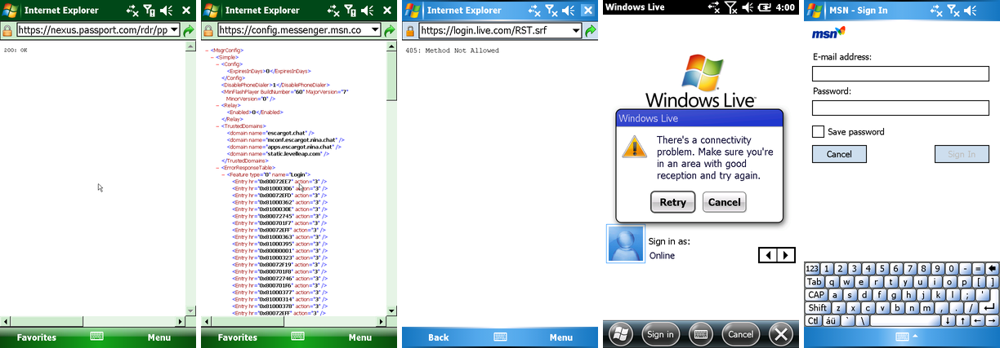
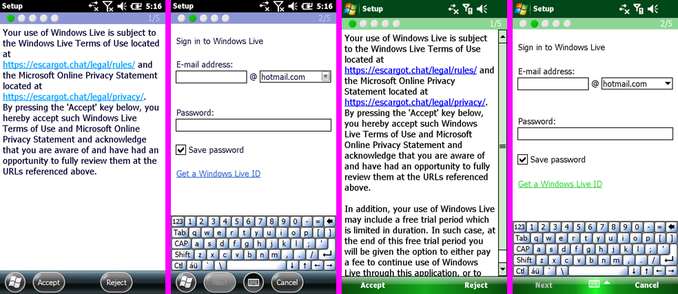

# Windows Live Messenger / MSN on Escargot

[Escargot](https://escargot.chat/) runs MSN Messenger's servers again. This page covers which Messenger client
each Windows Mobile image ships, what those clients talk to, what Escargot serves, and what PocketStylus does
about it with the **Windows Live Messenger via Escargot** setting.

Tags as in the other research docs: **[MEASURED]** = seen in the CLI on the phone or probed from the PC
(2026-10-16), **[ROM]** = read from the images' files or registry, **[SRC]** = a cited web source,
**[INFERRED]** = reasoning not checked directly.



*Left to right: IE Mobile on 6.1.4 opening `https://nexus.passport.com/rdr/pprdr.asp` and
`https://config.messenger.msn.com/Config/MsgrConfig.asmx`, and on WM 5.0 opening `https://login.live.com/RST.srf`.
All three are answered by Escargot with no certificate warning. Then the stock clients: Windows Live on 6.5.3
fails with "There's a connectivity problem" (it wants `http.mws.mobile.live.com`), and Pocket MSN's
Messenger sign-in on WM 5.0.*

---

## Summary

> **Update (§8): a gateway prototype gets the built-in Windows Live client of 6.5.3 and 6.1.4 through
> its setup to the e-mail/password page, and turns its Live ID sign-in into an MSNP sign-in at
> Escargot.** Sign-in itself and everything after it (contacts, chat) are not done or not tested. The
> rest of this summary is the first round's finding and still holds for DNS remaps alone and for WM 5.0.

- **The Messenger clients built into these three images can't sign in to Escargot, and a DNS remap can't
  change that.**
  - WM 6.5.3 and 6.1.4 ship *Windows Live for Windows Mobile*. It talks to Microsoft's **Mobile Web Services
    (MWS)** gateway, not to MSNP servers.
  - WM 5.0 ships *Pocket MSN*. It talks to Microsoft's **MSN Mobile "MSP" session service**.
  - Escargot implements neither; it serves only the desktop protocol (MSNP 2–18) and its HTTP side services.
    This matches WebOne's notes and the NINA FAQ (§4).
- **What does work [MEASURED on all three images]:** the setting answers Microsoft's Messenger and Passport
  names with Escargot's servers.
  - The secure web proxy then terminates the guest's HTTPS with a certificate for the original name, checks
    Escargot's real certificate, and fixes up the HTTP so Escargot accepts it.
  - A classic MSNP client installed in WM that has Microsoft's names built in reaches Escargot without
    patching: MSNP on TCP 1863, Tweener login, RST/SSO, address book, storage and config.
- **What you need to do:** make an Escargot account, then test with a classic client (§7). No client of that
  kind ships in these images, and sign-in itself wasn't tested here, because that needs an account and its
  password.

## 1. Which client each image ships [ROM]

| Image | Client | Files | Server it uses |
|---|---|---|---|
| 6.5.3 (`PPC_USA_GSM_FWVGA_VR.BIN`) | Windows Live for Windows Mobile 6.0 ("Windows Live Messenger") | `WLMMessenger.exe`, `WLMMessengerPlugin.dll`, `WLMService.dll`, `WLMShared.dll`, `WLMLauncher.exe`, `WLMSetup.exe` and about 40 more `WLM*` modules | MWS: `http.mws.mobile.live.com` (HTTPS/SOAP), `tcp.mws.mobile.live.com:50001` |
| 6.1.4 (`PPC_USA_GSM_480x800.BIN`) | the same Windows Live 6.0 package | the same `WLM*` set | the same |
| 5.0 (`PPC_USA_GSM_VGA_VR.BIN`) | Pocket MSN (MSN Messenger, MSN Hotmail, MSN Mobile) | `pmsnlauncher.exe`, `pmsnserver.exe`, `pmsnshared.dll`, `pmsnhotmail.dll`, `msnmobileplus.dll`, `pmsn.cpl` | MSP: `session.mobile.msn.com/MSPListen/MSPSession.aspx` (HTTP), `services.mobile.msn.com` (TCP) |

**How these were found:**
- Files were extracted with the scratchpad IMGFS and XIP tools.
- For WM 5.0, whose XIP modules are compressed, strings came from a RAM dump (`--dump-ram`) taken with Pocket
  MSN's Messenger open.
- The 6.x registry came from the ROM's `default.hv`.

**Registry, 6.5.3 / 6.1.4:**

```
[HKLM\Services\Windows Live\Platform\Transport]   Server = tcp.mws.mobile.live.com   Port = 50001
[HKLM\Services\Windows Live\Platform\Passport]    Policy = https://http.mws.mobile.live.com/2006/10/MWP2007_02/SecurityPolicy/Default.aspx
[HKLM\Services\Windows Live\Plugins\Messaging]    Dll = WLMMessengerPlugin.dll
[HKLM\Software\Microsoft\Windows Live]            DefaultDomainList = hotmail.com;live.com;msn.com;
```

**What `WLMService.dll` contains:**
- The PPCRL `RequestMultipleSecurityTokens` SOAP request (`http://Passport.NET/tb`, `wsse:UsernameToken`).
- MWS policy XPaths (`mws:RPSCluster`, `mws:LiveIdSignUpUrl`) and `tcp://`.
- Event names inherited from Pocket MSN (`PocketMSNServer_SocketUpEvent`, `MSPPDUGateway_TimeChangeEvent`).

**What `WLMMessenger.exe` / `WLMMessengerPlugin.dll` contain:**
- Only MWS schemas: `http://schemas.live.com/mws/2006/10/messaging`, `…/contacts`, and `ws/2005/08/ssync`.
- **No MSNP** at all: no `VER`/`CVR`/`USR`, no `MSNP`, no `1863`, no `messenger.hotmail.com`.

**What Pocket MSN contains (WM 5.0, from RAM):**
- `pmsnserver.exe` configuration: `HTTP` / `Path` = `/MSPListen/MSPSession.aspx` / `Server` =
  `session.mobile.msn.com`, and `Server` = `services.mobile.msn.com` with `AutoConnect` / `Port` / `KeepAlive`.
- Plus `http://mobile.msn.com/pocketpc/` and `mobile.msn.com/getsms`.
- Again **no MSNP** strings. `msim.dll` in this image is the handwriting input method, not a messenger.

## 2. What the clients do on the network [MEASURED]

**CLI setup:**
- Base states with the current helper and a private CA in WM's root store (`esc/b*/ca.wms`).
- `--log debug` turns on the new usernet lines `net: DNS <name> -> <addresses>` and `net: TCP to <ip>:<port>`.

**Windows Live (6.5.3 and 6.1.4):**
- On *Sign in*, the client looks up `http.mws.mobile.live.com` and nothing else:
  `D net: DNS http.mws.mobile.live.com -> (none)`.
- It shows *"There's a connectivity problem. Make sure you're in an area with good reception and try
  again."*
- The name still exists in Microsoft's DNS but has no A record today [MEASURED, nslookup].
- No credentials are asked for before this step.

**Pocket MSN (5.0):**
- *MSN Messenger → Sign In* asks for an e-mail address and password before any network traffic.
- I stopped there: signing in would send a password.
- `session.mobile.msn.com` still resolves to a Microsoft address (65.55.161.250, CNAME
  `notify.mobile.msn.com`) [MEASURED]. So with the setting off, a test sign-in would send the password to
  Microsoft. Leave this client alone, or remap its names to a dead address first (§7).

## 3. What Escargot serves [MEASURED, SRC]

**Servers:**
- `msnmsgr.escargot.chat` is a CNAME for `ds.escargot.nina.chat`, at 143.198.4.104.
- `conf.escargot.chat` is at 104.236.95.230.
- These are the current client settings per Escargot's *urgent client repatch* notice
  (https://www.escargot.chat/news/120500000101140/urgent-client-repatch-required/). Older guides use
  `ds.escargot.nina.chat` / `mconf.escargot.nina.chat`
  (https://wiki.nina.chat/wiki/Protocols/MSNP/How_to_move).

**MSNP, TCP 1863:**
- `VER 1 MSNP8 CVR0` gets `VER 1 MSNP8`.
- `CVR 2 0x0409 winnt 5.1 i386 MSNMSGR 6.2.0137 MSMSGS …` gets
  `CVR 2 6.2.0137 6.2.0137 6.2.0137 https://escargot.chat https://escargot.chat`.
- Supported versions: MSNP2–18, with MD5 login up to MSNP7, Tweener (TWN) for MSNP8–14 and SSO/RST from
  MSNP15. Tested clients are MSN 1 to WLM 2009 (https://gitlab.com/escargot-chat/server README and
  `front/msn/msnp_ns.py`; https://escargot.chat/).

**HTTPS on 443:**
- Escargot answers **only to its own names**:
  - `Host: msnmsgr.escargot.chat` → `GET /rdr/pprdr.asp` returns 200.
  - `Host: nexus.passport.com` returns **404**, whether by `--resolve` or with an explicit Host header.
- The certificate is `CN=ds.escargot.nina.chat` from Google Trust Services WR1, with SANs
  `m1.escargot.chat`, `msnmsgr.escargot.chat`, `sysboard.escargot.chat` and `*.nina` API names.
- `conf.escargot.chat` has its own certificate, `CN=nina.chat`, with SAN `conf.escargot.chat`.
- Neither covers any Microsoft name, so a plain hosts-file redirect fails certificate checks too.

**Header spelling:**
- Nexus answers `Passporturls: DALogin=https://ds.escargot.nina.chat/login`, where Microsoft sent
  `PassportURLs`.
- Old clients that compare header names case-sensitively break on this. The Pocket PC MSN Messenger is the
  reported case (https://wink.messengergeek.com/t/can-i-still-use-msn-messenger-for-pocket-pc/6086).

**Endpoints:**
- `/RST.srf`, `/RST2.srf`, `/login` (Tweener DALogin), `/abservice/abservice.asmx`,
  `/storageservice/SchematizedStore.asmx`, and `/gateway/gateway.dll` (HTTP gateway, port 80) all exist.
- Plain `GET` to these returns 405 or 500.
- `/login2.srf` returns 404; WebOne maps it to `/login`.
- `conf.escargot.chat/Config/MsgrConfig.asmx` returns the config XML.

**Mobile services:**
- There is no handler for `*.mobile.msn.com`, `*.mobile.live.com` or MWS.
- WebOne's `escargot.conf` redirects the mobile names, but its wiki says Pocket MSN and "mobile Windows Live
  Messenger 10.6" don't work (https://github.com/atauenis/webone/wiki/Using-with-MSN-Messenger,
  https://github.com/atauenis/webone/blob/master/escargot.conf).
- The NINA FAQ: no known Windows Mobile/CE MSN client has worked (https://wiki.nina.chat/wiki/FAQ).

**Accounts:**
- An Escargot account is free (https://account.escargot.chat/register/); a Microsoft account doesn't work.
- Sign-in uses the website password. An optional *legacy password* (`/account/legacy/`) is meant for clients
  without secure login (https://escargot.chat/faq/).
- The rules forbid proxy abuse and more than 3 clones per host, and say nothing against third-party clients
  (https://escargot.chat/legal/rules/).

## 4. What's missing for the stock clients

| Client | Needs | Escargot has | Gap |
|---|---|---|---|
| Windows Live 6.0 (6.5.3, 6.1.4) | MWS: SecurityPolicy over HTTPS, PPCRL RST with HMAC-signed WS-Security SOAP, `mws/2006/10/*` contacts/messaging/ssync SOAP, and a binary push channel on `tcp.mws.mobile.live.com:50001` | MSNP 2–18 and desktop SOAP services | the whole MWS middle tier |
| Pocket MSN (5.0) | MSP: `session.mobile.msn.com/MSPListen/MSPSession.aspx` + `services.mobile.msn.com` TCP | none of it | the whole MSP middle tier |

**Is a translation shim feasible? Not as a small piece of work [INFERRED].**
- Both protocols were private Microsoft middle tiers, and no specification or public capture is known.
- A shim would have to play the gateway in full:
  - mint PPCRL tokens and proof keys the client accepts and signs with;
  - answer ssync/eventing SOAP for contacts and presence;
  - keep the 50001 push channel for WLM, and the MSP equivalent for Pocket MSN;
  - log in to Escargot over MSNP15+ on the user's behalf.
- That is a reverse-engineering project on its own, so it was left out.
- The simpler fix-ups that Escargot does need from classic clients (§5) are implemented.

## 5. Implementation

### Setting: **Windows Live Messenger via Escargot** (page Network, per OS, off by default)

- `Settings.escargot` (`net.escargot`) is per OS like the other device settings, because whether it helps
  depends on what the user installed in that OS.
- It is off by default: while it is on, WM's `login.live.com` and Passport names go to Escargot, IE Mobile
  included.
- It applies live: `EmulatorActivity` calls `NativeBridge.setEscargot(handle, on)` when the session starts and
  from `applyLiveSettings`, which calls `UserNet::setHostRules`.
- New lookups follow at once. WM caches DNS answers for 60 s.
- HTTPS to the remapped names needs **Secure Web Proxy** (on by default). MSNP on 1863 needs only the DNS
  answer.

### Rule set (`core/src/net/revival.h`, `escargotHostRules()`)

| Microsoft name | Escargot target | Used for |
|---|---|---|
| `messenger.hotmail.com` | `msnmsgr.escargot.chat` | notification server, MSNP on TCP 1863 |
| `gateway.messenger.hotmail.com` | `msnmsgr.escargot.chat` | HTTP gateway (see the limits below) |
| `nexus.passport.com` | `msnmsgr.escargot.chat` | Tweener `/rdr/pprdr.asp` |
| `login.passport.com`, `loginnet.passport.com`, `login.live.com` | `msnmsgr.escargot.chat` | Tweener `login2.srf` (sent as `/login`), RST.srf / RST2.srf |
| `.contacts.msn.com`, `.storage.msn.com` | `msnmsgr.escargot.chat` | ABCH address book, storage |
| `ows.messenger.msn.com`, `rsi.hotmail.com`, `sup.live.com` | `msnmsgr.escargot.chat` | offline messages, sharing |
| `config.messenger.msn.com` | `conf.escargot.chat` | `MsgrConfig.asmx` |
| `ds.escargot.nina.chat`, `msnmsgr.escargot.chat`, `m1.escargot.chat` | themselves | the header fix also for Escargot's own DALogin URL |

- The list follows WebOne's `escargot.conf`.
- The mobile names are left out on purpose. Escargot has nothing behind them, and they'd only send the stock
  clients' credentials somewhere else to fail.
  - Since §8 the setting also sends `.mws.mobile.live.com`, `session.mobile.msn.com` and
    `services.mobile.msn.com` to the local gateway at 10.0.2.4. Nothing about them goes to Escargot or
    Microsoft.
- CLI: `--escargot` installs the same rules after any `--host-map` rules, so a `--host-map` for the same name
  wins.

### Secure web proxy changes (small; `HostRule::http`, `revival.h`, two hooks in `tlsproxy.cpp`)

- The DNS memory records the **original** name, as described in research-tls-proxy.md §6. So the guest gets a
  certificate for `nexus.passport.com` and the upstream is validated as `msnmsgr.escargot.chat`. No rule turns
  off validation.
- For rules marked `http`, the proxy changes three things:
  - **Request:** `Host:` becomes the target name, and `Connection: close` replaces the guest's keep-alive.
    Without close, a second request on the same connection would carry the old Host header and get a 404.
  - **Request:** for the login hosts, `GET /login2.srf` is sent as `/login`, as WebOne does.
  - **Response:** in the first response head, `PassportURLs`, `Authentication-Info`, `WWW-Authenticate` and
    `X-MSN-Messenger` get Microsoft's spelling.
- `--log debug` shows each rewrite, for example:

```
D net: DNS nexus.passport.com -> 143.198.4.104 via rule msnmsgr.escargot.chat
I tls: 143.198.4.104:443 nexus.passport.com via msnmsgr.escargot.chat, guest TLSv1 AES128-SHA, server TLSv1.2 ECDHE-RSA-AES128-GCM-SHA256
D tls: revival: "GET /rdr/pprdr.asp HTTP/1.1" for nexus.passport.com sent with Host msnmsgr.escargot.chat
D tls: revival: response header Passporturls spelled as PassportURLs
D net: DNS login.passport.com -> 143.198.4.104 via rule msnmsgr.escargot.chat
D tls: revival: "GET /login HTTP/1.1" for login.passport.com sent with Host msnmsgr.escargot.chat
```

(The last request was `GET /login2.srf` in the guest.)

### Limits

- **HTTP gateway on port 80.** Plain HTTP isn't proxied, so its Host header stays
  `gateway.messenger.hotmail.com`. MSNP clients use the gateway only when TCP 1863 fails, and 1863 works
  through usernet [INFERRED].
- **Header spelling.** Only the first response head on each connection is fixed. With `Connection: close`
  that is every response.
- **Hosts that answer only to their own name.** Any other client hostname would need a new rule in
  `revival.h`.

## 6. Verification (CLI on the phone)

```
# esc/t.sh <run> <secs> <snippet>: loads esc/b<os>/ca.wms (helper + this CA installed) with
#   --net --tls esc/ca --log debug, the snippet adds e.g. --escargot and --put "…:run \Windows\iexplore.exe URL"
OSES="653 614 5" sh esc/t.sh r4 85 esc/s4.sh
```

| Test | 6.5.3 | 6.1.4 | 5.0 |
|---|---|---|---|
| Stock client, *Sign in* | DNS `http.mws.mobile.live.com` → none; "connectivity problem" | same | sign-in form, no traffic before credentials |
| `--escargot`, IE `https://nexus.passport.com/rdr/pprdr.asp` | `200: OK` from Escargot, `PassportURLs` fixed | same, padlock | same |
| IE `https://config.messenger.msn.com/Config/MsgrConfig.asmx` | Escargot's config XML (`TrustedDomains` escargot.chat …) | same | same (after IE's mixed-content prompt) |
| IE `https://login.live.com/RST.srf` (GET) | `405: Method Not Allowed` from Escargot | same | same |
| IE `https://ds.escargot.nina.chat/login`, `https://login.passport.com/login2.srf` | not run | both reach Escargot as `GET /login` (log in §5; 500 without a Passport header) | not run |
| Guest / upstream TLS | TLSv1 AES128-SHA / TLSv1.2 ECDHE-RSA-AES128-GCM or TLSv1.3 | same | TLSv1 DES-CBC3-SHA / same |

- Sign-in was not tested: it needs an Escargot account and password (§7).
- MSNP 1863 was probed from the PC only (`VER`/`CVR`, §3), since no image has an MSNP client.

## 7. What you can test

1. Make a free Escargot account at https://account.escargot.chat/register/. If your client has no "secure
   login", also set a *legacy password*.
2. In WM, open *PocketStylus settings → Network* and turn on **Windows Live Messenger via Escargot**. Keep
   **Secure Web Proxy** on.
3. Check the plumbing in IE Mobile:
   - `https://nexus.passport.com/rdr/pprdr.asp` should show `200: OK` with a padlock.
   - `https://config.messenger.msn.com/Config/MsgrConfig.asmx` should show XML that mentions escargot.chat.
4. Sign in with a **classic MSNP client** installed in WM, one that has `messenger.hotmail.com` /
   `nexus.passport.com` / `login.live.com` built in (MSNP 8–18). For example, a Pocket PC build of MSN
   Messenger, or another third-party MSNP client CAB.
   - Clients already set to Escargot's own names (for example the community "Pocket Escargot" MSNP4 client,
     https://wink.messengergeek.com/t/im-using-escargot-on-windows-mobile/28182) don't need the setting, only
     the secure web proxy for their HTTPS.
   - Install only CABs you trust.
5. To confirm the stock clients' behaviour, don't type your password into them with the setting off: Pocket
   MSN would send it to Microsoft. Windows Live 6.0 stops before asking.
   - To see where Pocket MSN goes without sending anything, use the CLI with
     `--host-map .msn.com=10.0.2.99 --host-map .live.com=10.0.2.99 --log debug`. Every lookup then answers a
     dead local address, and connections are refused inside usernet (`net: TCP to 10.0.2.99:<port> refused`).
6. If a classic client fails, a CLI run with `--escargot --log debug` shows each name, each rewrite and
   Escargot's answer. Please send that log.

## 8. Patching the stock clients for the classic endpoints (second round, 2026-10-16)

The question: can the clients built into the images be made to sign in to Escargot? Three routes were
weighed: patch the client binaries, translate on the host, or something in between.



*6.5.3 (left pair) and 6.1.4 (right pair) with `--mws`: the client accepted the gateway's security policy,
shows Escargot's rules and privacy links in its terms page (setup 1/5), and after Accept asks for the
e-mail address and password (2/5). That page is where these tests stop.*

### 8.1 What each client speaks [ROM, MEASURED]

**Windows Live for Windows Mobile 10.6.0042 (6.5.3, 6.1.4).** There is no MSNP stack to switch on:
- No `VER`/`CVR`/`USR`/`MSNP`/`1863`/`nexus` in any of the ~40 `WLM*` modules, and no registry or config
  switch for another protocol. The only server settings are the policy URL
  (`HKLM\Services\Windows Live\Platform\Passport\Policy`) and the push channel
  (`...\Platform\Transport` Server/Port), and both lead to MWS.
- MWS is **SOAP 1.2 over HTTPS** (WinInet, `User-Agent: Mozilla/4.0 (compatible; MSIE 4.01; Windows CE)`),
  in four steps:
  1. `GET https://http.mws.mobile.live.com/2006/10/MWP2007_02/SecurityPolicy/Default.aspx`: a WS-Policy
     document. WLMService.dll reads it with MSXML using XSL patterns with literal prefixes (the patterns are
     in the DLL): `/wsp:Policy/sp:SymmetricBinding/.../sp:IssuedToken[./sp:RequestSecurityTokenTemplate/wst:TokenType="urn:passport:compact"]`
     with `sp:Issuer/wsa:Address` (the Live ID issuer), `sp:Issuer/wsa:ReferenceProperties/mws:LiveIdSignUpUrl`,
     `mws:Privacy`, `mws:TOU`, `mws:RPSCluster`, `sp:RequestSecurityTokenTemplate/wsp:PolicyReference`,
     and `/wsp:Policy/mws:metadatavalidity/mws:Expiry`; optional `/wsp:Policy/mws:Dictionaries/mws:MobileService`.
  2. A PPCRL `RequestMultipleSecurityTokens` POST to the issuer, with `wsse:Username` / `wsse:Password`
     in plain text inside TLS. It wants back `urn:passport:compact` tokens with a `wst:BinarySecret`
     proof key and `wst:LifeTime/wsu:Expires`.
  3. Service calls signed with HMAC-SHA1 over the proof key (`ds:SignedInfo` over `wsa:Action`, `To`,
     `MessageID`, `ReplyTo`, `wsu:Timestamp`), with `mws:DeviceOptions`, `mws:Application` and a
     `wsa:ReplyTo` carrying `mws:DeviceAddress`.
  4. Push to the phone over `tcp.mws.mobile.live.com:50001` (heartbeat, data-ack and TTL back-off threads in
     WLMService.dll).
- The messaging service is **SIP-shaped SOAP** (`http://schemas.live.com/mws/2006/10/messaging`):
  `sip:RegisterRequest` (presence, `sip:Expires`, `sip:Capabilities`), `sip:InviteRequest`,
  `sip:MessageRequest` (`sip:MessageBody`, `sip:ContentType` text/plain, `X-Nudge`, `X-VoiceClip`),
  `sip:ByeRequest`, `sip:ReferRequest`, object transfer, and faults such as `UserOffline`,
  `RegistrationExpired`. Contacts come by ssync (`DataSetChanges`, `LearnedKnowledge`,
  `http://schemas.xmlsoap.org/ws/2005/08/ssync`). These map closely onto MSNP (USR/CHG, XFR SB/CAL,
  MSG, OUT, the contact list).

**Captured first exchange (6.5.3; 6.1.4 is byte-identical):**

```
GET /2006/10/MWP2007_02/SecurityPolicy/Default.aspx HTTP/1.1
User-Agent: Mozilla/4.0 (compatible; MSIE 4.01; Windows CE)
Host: http.mws.mobile.live.com
Connection: Keep-Alive
```

Guest TLS: TLSv1 AES128-SHA, through the secure web proxy's certificate for `http.mws.mobile.live.com`.

**Pocket MSN (5.0)** speaks Microsoft's MSP: an HTTP session at
`session.mobile.msn.com/MSPListen/MSPSession.aspx` plus a TCP connection to `services.mobile.msn.com`
(`MSPPDUGateway`, a PDU protocol). It has no MSNP strings either. Its *Sign In* button stays disabled until
a password is typed, and it sends nothing before that, so no capture was possible within this task's limits
(no passwords typed).

### 8.2 The routes

| Route | Verdict |
|---|---|
| 1. Binary or registry patch to an MSNP code path | **Not possible**: neither client contains an MSNP stack. A patch would have to add a whole client. |
| 3. Patch only names and ports | **Not enough**: the protocol isn't MSNP, so pointing it at port 1863 gets nowhere. |
| 2. Host-side translator (MWS → MSNP) | **Tractable for Windows Live 10.6**: self-describing XML, the queries the client makes are in its DLLs, and the messaging operations map onto MSNP. Built as a prototype (§8.3). Not for Pocket MSN for now: its binary MSP is undocumented and can't be captured without typing a password. |

No guest binary is modified. The only guest-side change is optional: the domain list on the sign-in page
(§8.5).

### 8.3 What was built: the Windows Live Mobile gateway

- **Local services** (`core/src/net/localsvc.h`, new): a service inside PocketStylus at **10.0.2.4**.
  - UserNet hands plain TCP connections to that address to the service.
  - Connections to a secure-web-proxy port go through the proxy first. It terminates the guest's TLS as for
    any site and hands the service the decrypted stream (`TlsProxy::Impl::relayPlain`).
  - Nothing leaves the phone on that leg.
- **Gateway** (`core/src/net/mwsgate.{h,cpp}`, new). DNS rules send `.mws.mobile.live.com` to 10.0.2.4.
  - **Security policy:** served with the issuer at `https://http.mws.mobile.live.com/RST.srf`, Escargot's
    rules/privacy/register pages as TOU/Privacy/sign-up, RPS cluster `mobile.live.com`, and 30 days'
    validity. The client accepts it (screenshots above).
  - **Live ID sign-in (RST):** the gateway takes the e-mail address and password from the request and signs
    in to **Escargot with MSNP8 + Tweener**, the way MSN Messenger 6.2 does:
    - `VER MSNP8` → `CVR` → `USR TWN I`, following any `XFR NS`.
    - Escargot's nexus (`https://msnmsgr.escargot.chat/rdr/pprdr.asp`, header spelling ignored) gives the
      DALogin URL.
    - `Authorization: Passport1.4 ...sign-in=,pwd=,<challenge>` there returns the `from-PP` ticket.
    - Then `USR TWN S` → `USR OK`.
    - Then `SYN 0` (contact list), `CHG NLN`, `PNG` every 45 s, and `CHL` answered with `QRY`
      (MD5 with MSN 6.x's public client key).
  - **Answer to the client:** an RSTR collection with a compact token and a random proof key per requested
    token. A failed sign-in returns a PPCRL fault: `0x80048821` for a wrong name or password, `0x80048823`
    when Escargot can't be reached.
  - **Sessions:** the MSNP session signs out after 15 minutes without client requests.
  - **Name fix:** a name with two `@` (an address typed whole, plus the page's domain) loses the second
    domain.
  - **Everything else** (the MWS service calls, the push channel on 50001, Pocket MSN's two names) is
    **captured and answered 503**, or only captured for raw TCP.
  - **Capture:** one numbered file per connection. Passwords, tokens, proof keys, signatures,
    `Authorization` / `Authentication-Info` / cookies and Passport tickets are replaced by `(redacted)`
    before anything is written. At most 500 files.
- **App:** the existing **Windows Live Messenger via Escargot** setting (`NativeBridge.setEscargot`, `jni.cpp`)
  now also installs the gateway and its DNS rules.
  - The capture goes to `<secure web proxy folder>/mws-capture` (app-private storage).
  - No Kotlin change.
  - With the setting off, the gateway is removed.
- **CLI:**
  - `--mws DIR`: gateway, capture in DIR.
  - `--mws-fake`: sign in to a fake MSNP8 server on 127.0.0.1 instead of Escargot.
  - `wmcore-cli --mws-selftest [--probe] [--capture DIR]`: the gateway without a guest (§8.4).
  - Sources: `core/cli/mws_test.cpp`.

### 8.4 How far it got [MEASURED, CLI on the phone]

| Step | 6.5.3 | 6.1.4 |
|---|---|---|
| *Sign in* → policy request reaches the gateway through the proxy | yes (`I tls: 10.0.2.4:443 http.mws.mobile.live.com to the local service, guest TLSv1 AES128-SHA`) | yes |
| Client accepts the policy; setup 1/5 shows Escargot's terms links | yes | yes |
| *Accept* → setup 2/5 *Sign in to Windows Live* (e-mail @ domain, password) | yes | yes |
| Typing an e-mail address only: *Next* stays disabled until a password is typed | yes | yes |
| Client sends the RST to the gateway | **not tested**: needs a password typed into the client | same |

**Host-side self-test** (`--mws-selftest --probe`, on the phone). It plays the client with the RST that
WLMService.dll builds and a made-up account against the fake server:

```
VER -> VER 1 MSNP8
CVR -> CVR 2 6.2.0137 6.2.0137 6.2.0137 https://escargot.chat https://escargot.chat
nexus -> HTTP 200, DALogin https://ds.escargot.nina.chat/login
PASS  Escargot reachable (MSNP8 VER/CVR, Passport nexus with DALogin)
PASS  security policy served
PASS  Live ID sign-in turned into an MSNP8/Tweener sign-in and answered
PASS  token response has compact tokens and proof keys for the client
```

In that run the gateway went through `VER`, `CVR`, `USR TWN I`, the nexus, DALogin, `USR TWN S`, `USR OK`,
`SYN` (1 contact), `CHG NLN` and a correct `QRY` against the fake server. Against Escargot only `VER`/`CVR`
and the nexus lookup were sent: no `USR`, no account.

**Not known yet [INFERRED]:**
- Whether the client accepts the gateway's RST response. Its shape follows the client's own XPaths; the
  prefixes are literal (`S:`, `wst:`, `wsse:`, `wsu:`).
- Whether Escargot accepts the website password over Tweener, or wants the *legacy password*.
- What the client calls next. After sign-in, the next calls (Register, contacts sync, the 50001 channel)
  get 503, so the client will most likely report a problem right after the sign-in. The capture of those
  calls is what the next step needs.

### 8.5 What you need to do to try the sign-in

1. Turn on **Windows Live Messenger via Escargot** (*PocketStylus settings → Network*). Keep **Secure Web
   Proxy** on. This needs an APK with this change.
2. In WM 6.5.3 or 6.1.4, open **Windows Live** (Messenger) → *Sign in* → read and *Accept* the terms page,
   which now shows Escargot's links.
3. On *Sign in to Windows Live*, enter your Escargot address and password.
   - If your address is at hotmail.com / live.com / msn.com, type the name and pick the domain.
   - Otherwise type the **whole address** in the name field. The gateway drops the extra `@domain` the
     page adds.
   - If sign-in fails with a password error, set a *legacy password* at
     https://account.escargot.chat/account/legacy/ and try that.
4. Expect at best a signed-in MSNP session at Escargot: others see you online. On the phone the client will
   probably stop with an error after the sign-in step, because contacts and chat aren't translated yet.
5. Send the capture so the next step can be built: `files/.../mws-capture` in the app's storage, the same
   folder as the proxy's CA. Secrets are already redacted, but look it over before sharing it.

**Same thing from the CLI (no app):**

```
wmcore-cli fwvga.bin --mem 192 --net --tls <ca dir> --load-state <state> --mws cap --log debug ...
```

**Without any account:** `--mws-fake` signs in to the built-in fake server; any password works.

### 8.6 What's left (for a working client)

1. Capture the calls after a real sign-in (§8.5) and answer them:
   - `RegisterRequest` → `CHG` presence.
   - Contacts ssync → the MSNP8 `SYN` list (`LST`).
   - `InviteRequest`/`MessageRequest`/`ByeRequest` → switchboard `XFR SB`/`CAL`/`MSG`/`OUT`.
   - Incoming `RNG`/`MSG` → push on the 50001 channel. Its framing is still unknown; that capture shows the
     client's side first.
2. Pocket MSN (5.0): capture MSP with a throwaway password into the gateway, which now owns
   `session.mobile.msn.com` / `services.mobile.msn.com` while the setting is on. Then judge whether its PDU
   protocol can be served.

## 9. The push channel on port 50001 (third round, 2026-10-16)

**The user's first real sign-in** (app, 6.5.3, with the whole Escargot address typed):
- RST.srf succeeded: the gateway signed in to Escargot with MSNP8/Tweener and returned its token.
- The client then connected to `tcp.mws.mobile.live.com:50001` and sent 24 bytes:
  `30 01 00 00 00 00 00 00 0c 00 00 03 08 02 01 00 00 06 01 00 08 02 0c 00`.
- It got no answer, gave up after about 15 s, and retried.
- A later retry with `name@hotmail.com` (the page's default domain) was refused by Escargot.

### 9.1 Framing [ROM: WLMService.dll 10.6 code]

The framing is the MSP PDU that Pocket MSN's `MSPPDUGateway` also used: a 12-byte header, then a chain of
options in the style of IPv6 extension headers, then the payload. Each fact below was read from the
receive thread (`TCP::_ThdRecv` at 0x42406c in the 6.1.4 DLL as mapped), the reassembler (0x40da44), the
dispatcher (0x40e8f4), the connect-answer handler (0x40e454) and the PDU builders. `core/src/net/mwspdu.h`
encodes it.

**Header (12 bytes):**

| Bytes | Field |
|---|---|
| 0 | `0x30`. Anything else is dropped. |
| 1 | type |
| 2–3 | message id (LE) |
| 4–7 | sequence (LE) |
| 8–9 | length of the rest (LE, at most 0x4000) |
| 10 | flags (bit 0: more fragments follow) |
| 11 | type of the first option (0: none) |

**Option:** `[type of the next option, 0 = last][data length][data]`. Sub-items inside an option's data
are `[01 00]` followed by `[id][len][bytes]`. Padding to 4 bytes is inside the data.

**Client types:**

| Type | Meaning |
|---|---|
| 0x01 | connect. Option 3 `01 00` + optional device id (`HKLM\Services\Windows Live\DID`); option 8 `01 00 08 02 0c 00`. |
| 0x02 | reconnect, with option 2 = the session |
| 0x03 | disconnect: option 2 session plus option 4 ack. Sent by 0x424714, which then closes the socket. |
| 0x04 | heartbeat: option 5 = TTL in seconds, u16. 270 s was seen. |
| 0x00 | data ack: option 4 = `01 00` + sequence u32 + `00 40 01 00` |
| 0x10 | data: option 0x10, whose second data byte is 3 for plain or 4 for zlib; zlib payloads start `78 BB` + the DICTID of a policy dictionary. Fragments are joined by message id. |

**Server types the client handles:**

| Type | Meaning |
|---|---|
| 0x81 / 0x82 | connect answer. **Option 2 is required:** `01 00 05 <len> <session id>`. Option 3 (device id, saved to the registry), 6 (a string), 8 (byte 4 must have bit 3) and 9 are optional; 0x81 also requires option 6. |
| 0x83 | logged only |
| 0x84 | heartbeat answer. Option 5 = next TTL, clamped to 90–7200 s. |
| 0x10 | data |
| 0xff | error. Option 0xfe holds a u16 code; 7 means reconnect. |
| 0x00 | control, with option 9 |

### 9.2 What the gateway does now [MEASURED]

| Client sends | Gateway answers |
|---|---|
| connect / reconnect | `0x82` with option 2 = a 10-character session id |
| heartbeat | `0x84` with the same TTL |
| disconnect | `0x83` |
| data | captured (reassembled, decoded when it is text), not answered yet |

Captures now give the real byte count in their headers. The earlier "140 bytes" was the hex dump's length.

**Host self-test:** `wmcore-cli --mws-selftest` now also replays the captured connect PDU and a heartbeat
(PASS).

**Guest run (CLI, 6.5.3, `--mws-fake`):**

```
push channel <- type 0x01 id 0 seq 0 flags 0 opt3[01 00] opt8[01 00 08 02 0c 00]
push channel -> type 0x82 id 0 seq 0 flags 0 opt2[01 00 05 0a <10-character session id>]
push channel <- type 0x04 id 0 seq 0 flags 0 opt5[0e 01]
push channel -> type 0x84 id 0 seq 0 flags 0 opt5[0e 01]
push channel <- type 0x03 ... opt2[session] opt4[01 00 00 00 00 00 00 40 01 00]
```

- The client **accepts the connect answer**: setup goes on to 3/5 (Today screen), 4/5 (contacts, e-mail)
  and 5/5.
- Setup 5/5 then shows *Synchronization failed*, and Messenger shows *There was a problem signing you in
  to Messenger*.
- No data PDU and no further HTTPS call came before the client sent its disconnect. Contacts and Messenger
  sign-in therefore expect something the gateway doesn't send yet. Candidates:
  - option 4 in the connect answer (the receive thread reads a u32 and a byte from it on 0x82);
  - an unsolicited 0x10 message;
  - the Dictionaries in the policy.

That needs the client's next requests, or the code that decides to disconnect. It is the next step.

### 9.3 Address memory

- After a successful sign-in the gateway remembers the address and maps `name@hotmail.com`, `@live.com` or
  `@msn.com` back to it when the name before the `@` matches.
- It is kept in memory and in `<secure web proxy folder>/mws-addresses.txt`: addresses only, no secrets.
- A new sign-in of the same address ends that address's older MSNP session.

## 10. "Personal settings: failed to synchronise" (fourth round, 2026-10-16)

**The user's retest on 6.5.3 with the full `@escargot.chat` address:** RST.srf 200, MSNP signed in (online
at Escargot), the push channel connected and the heartbeat was answered. Then **the client sent nothing** —
no further HTTPS on any host, no more 50001 data — and the phone showed *Personal settings: failed to
synchronise*.

### 10.1 Why [ROM: WLMService.dll 10.6 code]

The client won't start any plugin sync until the platform marks the connection *fully* up. That decision is
a registry value the plugins watch:

- `TCP::_ThdRecv` (0x4243c8) does, for **every received type-0x82 PDU**: `getOption(pdu, 4)`, and if present
  reads the u32 at the option entry + 4 into the TCP object field at `+0x29c`.
- The platform's connection-state function (0x40c918) writes
  `HKLM\Services\Windows Live\ConnectionStatus` (0x40ca18): when the connect state is 1 (a good handshake),
  the value is **4 when `+0x29c` > 0, else 1**.
- The plugins (profile = "personal settings", contacts, messaging) sync only at ConnectionStatus 4.

Our connect reply was a type-0x82 with option 2 only. With no option 4, `+0x29c` stayed 0, so
ConnectionStatus stayed 1 ("connecting"): the connection looked up but not *data-ready*, and nothing synced.

### 10.2 Fix [MEASURED host-side]

The connect reply now also carries **option 4** = `01 00` + a 4-byte sequence + `00 40 01 00`, the client's
own option-4 shape, with the sequence set to 1. The word the DLL reads is then nonzero, so `+0x29c` > 0 and
ConnectionStatus becomes 4.

- The connect handler (0x40e454) processes only options 2, 3, 6, 8 and 9, so adding option 4 doesn't touch
  the working connect; only the recv-thread sequence logic reads it.
- `wmcore-cli --mws-selftest` now reimplements the DLL's extraction and the ConnectionStatus formula and
  checks the reply yields 4 (PASS).

### 10.3 What the user should retest

1. New APK, 6.5.3, full `@escargot.chat` address, **Windows Live Messenger via Escargot** on.
2. Expect setup to get past *failed to synchronise* at the connection level. Two outcomes are useful:
   - it reaches a later step or signs in to Messenger, or
   - it now **issues its sync** (HTTPS to `http.mws.mobile.live.com`, or data on 50001). Either is captured.
3. Send the `mws-capture` folder. The service calls after ConnectionStatus 4 are the next thing to
   translate (profile, contacts ssync, messaging Register), and this capture is the first chance to see
   them — the client sent nothing before.

### 10.4 Still open

- If the client still won't sync, the server likely has to push a first data (0x82) message rather than
  fold the sequence into the connect reply, or the connect reply needs option 6/8/9 too. The retest's
  capture decides.
- The MWS service layer (profile/contacts/messaging SOAP) is still unimplemented: it is captured and
  answered 503.

## Files

- `core/src/net/mwspdu.h` (new, §9): push-channel PDU framing.
- `core/src/net/localsvc.h` (new): local services at 10.0.2.4 (§8.3).
- `core/src/net/mwsgate.h`, `core/src/net/mwsgate.cpp` (new): Windows Live Mobile gateway, MSNP8/Tweener
  client, fake MSNP server for tests.
- `core/src/net/usernet.cpp`: TCP to 10.0.2.4 goes to the local service.
- `core/src/net/tlsproxy.{h,cpp}`: decrypted hand-off to the local service (`relayPlain`), `httpsExchange()`
  (validated HTTPS for local services).
- `core/cli/main.cpp` (`--mws`, `--mws-fake`, `--mws-selftest`), `core/cli/mws_test.cpp` (new).
- `core/CMakeLists.txt`, `tools/build-cli.sh`: the new sources.
- `app/src/main/cpp/jni.cpp`: `setEscargot` also installs the gateway.
- `docs/images/escargot-mws.png`.

First round:
- `core/src/net/revival.h` (new): Escargot rule set, request/response fix-ups.
- `core/src/net/tlsproxy.h`: `HostRule::http`.
- `core/src/net/tlsproxy.cpp`: includes `revival.h`; one hook before the relay (request), one in the relay
  (first response head).
- `core/src/net/usernet.cpp`: `--log debug` lines for DNS answers and TCP connects.
- `core/cli/main.cpp`: `--escargot`.
- `app/src/main/cpp/jni.cpp`: `NativeBridge.setEscargot`.
- `app/.../NativeBridge.kt`, `Settings.kt` (`escargot`), `GuestSettings.kt` (Network page),
  `EmulatorActivity.kt` (applies it at session start and live).
- `docs/images/escargot.png`.
