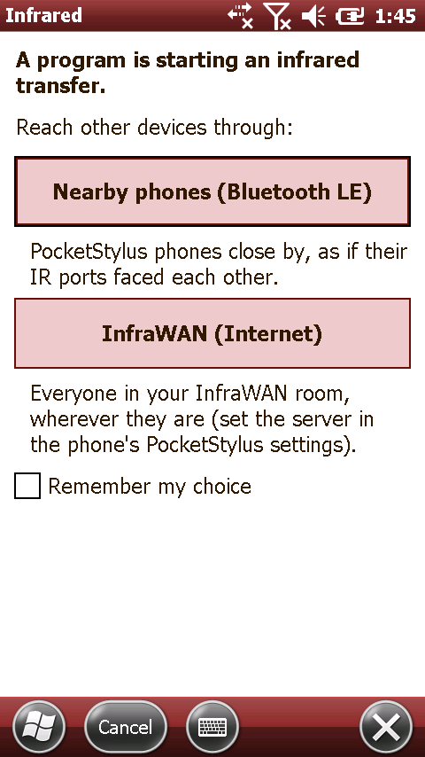
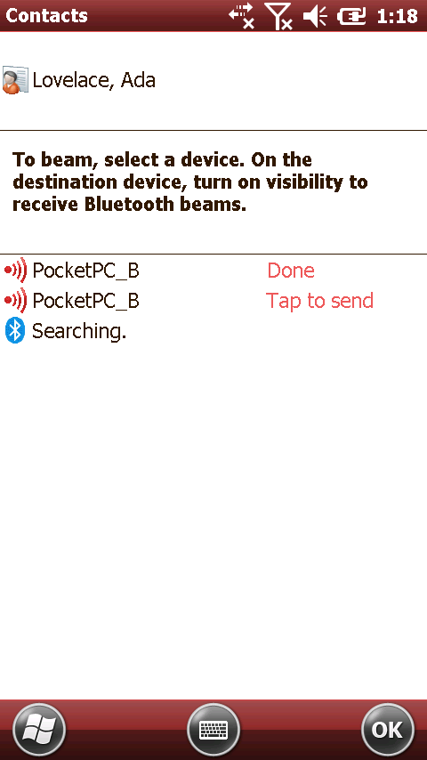
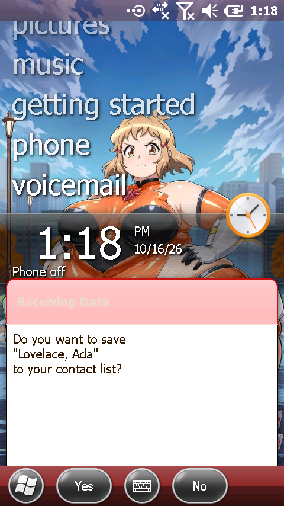

# Infrared (IrDA) over Bluetooth LE and InfraWAN

How PocketStylus gives Windows Mobile a working infrared port, and carries its beams to other phones.
There are two ways out: nearby phones over Bluetooth LE, or anyone in the same room on an InfraWAN
relay on the Internet. Main target: WM 6.5.3 `PPC_USA_GSM_FWVGA_VR.BIN`. WM 6.1.4 and WM 5 are checked too (§6).

Tags:

- **[ROM]**: read from the image or the running guest (helper `regdump` / `ls`; modules pulled out of IMGFS
  and disassembled with capstone).
- **[OBS]**: seen in the CLI (`/data/local/tmp/wm/irda`, `--irda-trace`).
- **[CODE]**: PocketStylus as built.
- **[DOC]**: IrDA specifications or Microsoft documentation, from memory.

DE's source was not used for any of this (license). It treats UART2 like any other UART and has no IR logic.

---

## TL;DR

| | Finding |
|---|---|
| Stack | **Complete in all three images**: `irdastk.dll` (IrLAP, IrLMP, TinyTP, IAS, AF_IRDA), the serial-IR NDIS miniport `irsir.dll`, `ircomm.dll` (COM3:), OBEX (`obexsrvr`, `obexapi`, `obexinbx`), `beam.exe`, and `System.Net.IrDA` in the GAC. [ROM] |
| Missing piece | Only the port. `Comm\Irsir1\Parms Port=2` makes irsir open **COM2:**. DE's port key `Drivers\BuiltIn\IRDA2410` names `IRDA2410.Dll`, which is not in the image. [ROM] |
| Fix, no guest code | Point that key at the stock `serial_smdk2410.dll` on UART2 with **`DeviceArrayIndex=1`**, which is the driver's second UART class. irsir then opens COM2 at boot and does the SIR framing in software. The core is the transceiver on the other end. [ROM][OBS] |
| Two more registry bits | `Software\Microsoft\Obex ObexServiceMask` bit 0 turns on OBEX over IrDA; the images ship 2 (Bluetooth only), so nothing could receive a beam. `Comm\IrDA DevAddr` gets its own random value per device. [ROM][OBS] |
| Core fix | The serial driver needs the UART's **level** TX interrupt. Before that fix, every frame longer than 16 bytes took about 256 ms to leave. [OBS] |
| Transport | Frames are IrLAP frames (address, control, information; the FCS is checked and stripped). They travel as opaque packets, and everyone on the transport hears everything, as in a room full of IR ports. |
| Timing | IrLAP waits 500 ms (F-timer) for each answer. The bridge answers discovery from a cache and drops repeated connection requests. With both, a contact beams and 20 KB transfers at up to **0.8 s round trip**. 1.5 s fails. [OBS] |
| Milestone | **A contact beamed from one emulated WM 6.5.3 to another, Contacts > Send Contact > Beam, both over a UDP pipe and through the InfraWAN relay.** The receiver asked "Do you want to save 'Lovelace, Ada'?", and after Yes the contact was in its store. [OBS] |
| Popup | When a program starts using IR, Windows Mobile shows a PocketStylus page offering *Nearby phones (Bluetooth LE)*, *InfraWAN (Internet)*, Cancel, and *Remember my choice*. Tested in the CLI. [OBS] |
| Not yet tested | Bluetooth LE between two real phones, and the app's InfraWAN client on the phone (the APK builds; it was not installed). |

<p align="center">
  
  
  
</p>

---

## 1. The IrDA stack in the images

### 1.1 Modules and registry (6.5.3) [ROM]

| Piece | Where |
|---|---|
| Protocol | `irdastk.dll`. `Comm\IrDA`: `DevAddr`, `Hints=0x8224`, `Baud=38`, `AutoSuspend=1`, `Linkage\Bind = Irsir1` |
| Miniport | `Comm\Irsir`: `ImagePath=irsir.dll`, `Group=NDIS`, `DisplayName="Serial (COM) IrDA Driver"`, `Linkage\Route = Irsir1`. `Comm\Irsir1\Parms`: `Port=2`, `Baud=63` (speed mask 2400-115200), `TransceiverType=1`, `IntIR=0`, `DisablePowerManagement=1`, `CheckForHangTimeInSeconds=3600` |
| IR port | `Drivers\BuiltIn\IRDA2410`: `Dll=IRDA2410.Dll` (**absent**), `IoBase=0x50008000` (UART2), `IoLen=0x2C`, `Irq=9`, `DeviceArrayIndex=1`, `Port=COM3:`, `Prefix=COM`, and no `Index`. It is never active. |
| IrCOMM | `Drivers\BuiltIn\IrCOMM`: `IRCOMM.DLL`, `Prefix=COM`, `Index=3`: **COM3:** (active) |
| OBEX | `Software\Microsoft\Obex`: `protocols=bth,irda`, `IsEnabled=1`, **`ObexServiceMask=2`**. Transport `{30a7bc02-…}` "IRDA" is in `OBEXAPI.dll`. The inbox service `{00000000-…}` is `obexinbx.dll`, which handles vCard/vCal through `pimutil.dll`. `Services\OBEX` (`OBEXSrVr.dll`, `OBX0:`) runs in services.exe. |
| UI | `beam.exe`, the Start menu's Beam icon, and *Send Contact > Beam*, which lists IrDA and Bluetooth devices. |
| Managed | `GAC_System.Net.IrDA_v3_5_0_0` (6.5.3), `v2_0_0_0` (6.1.4), `v1_0_5000_0` (WM 5) |

`irsir.dll` builds the port name as `COM%d:` from `Parms\Port`, so 2 means COM2:. COM3: belongs to
IrCOMM's virtual port.

### 1.2 Why the port never loaded, and the fix [ROM][OBS]

`serial_smdk2410.dll` (COM1's driver) reads `DeviceArrayIndex`, `InterruptBitsShift`, `ISTTimeouts`,
`WaterMarker`, `InterfaceType`, `Priority256` and `RxBufferSize`. Its object factory knows exactly
two UART classes:
- `DeviceArrayIndex` 0 creates the class with the DTR/DSR lines on GPH6/7 (COM1).
- `DeviceArrayIndex` 1 creates a second class without them: the BSP's IR UART.
- Any other value returns NULL, and the driver doesn't load. The first attempt used `DeviceArrayIndex=2` and failed this way.

The driver asks the OAL for a SYSINTR itself (`IOCTL_HAL_REQUEST_SYSINTR`, 0x01010098, from `Irq`)
and writes `SysIntr` back to its key.

The key the helper writes (`guest/Helper/Irda.cs`, `Irda.Provision`):

```
[Drivers\BuiltIn\IRDA2410]
Dll=serial_smdk2410.dll  Prefix=COM  Index=2  Port=COM2:
MemBase=0x50008000  MemLen=0x2C  Irq=15 (UART2)  InterruptBitsShift=6 (SUBSRCPND bits 6-8)
ISTTimeouts=0x200  DeviceArrayIndex=1  FriendlyName="Infrared Port (PocketStylus)"
```

`Index=2` is explicit, so the port can never take COM1 from the GPS or the modem.

After one restart, irsir opens COM2 at boot:
- `UBRDIV=0x149` (9600, the IrDA contact speed);
- `ULCON=3` (8N1; the driver does not set the S3C2410's infrared-mode bit 6, which only matters on real hardware);
- `UCON=0x385` (RX and TX interrupts, RX timeout, both of **level** type);
- FIFOs reset and enabled.

Nothing is transmitted until a program uses IrDA. There is no background discovery.

### 1.3 Three more things a beam needs [ROM][OBS]

1. **The UART's TX interrupt must be level-triggered** (UCON bit 9). The driver fills the 16-byte
   FIFO and waits for the "FIFO below trigger" interrupt. The core raised it as a single edge on
   each write, and the driver lost it, so longer frames waited for the IST timeout: about 256 ms
   per 16 bytes. SNRM took 305 ms to leave, and discovery answers missed their slots.

   `Uart::txLevel` (set for UART2 only) holds the TX sub-interrupt while TX interrupts are on. With
   it, frames leave in under 1 ms and the guest stays 97-98 % idle (no interrupt storm).

   The core's UART0 (GPS and modem) keeps the old edge behaviour, untouched.
2. **OBEX must listen on IrDA.** `obexsrvr.dll` reads `protocols`, and only if that contains
   `irda` **and** `ObexServiceMask & 1` does it register its IrDA listener (IAS classes `OBEX` and
   `OBEX:IrXfer`). The images ship `ObexServiceMask=2`, so a WM device never answered an IR beam.

   With no AF_IRDA socket open, the stack doesn't even answer discovery. It saw the XID commands
   and stayed silent. With mask 3, the receiving device answers and its OBEX inbox takes the vCard.
   (`OBX0:` IOCTL_SERVICE_STOP works, but START returns 1062; the restart after provisioning
   applies the mask instead.)
3. **Every device needs its own IrLAP address.** irdastk keeps it in `Comm\IrDA DevAddr`, read at
   start. Copies of one booted image share it: two test instances both had 0x23D, and IrLAP can't
   tell two stations with one address apart. The helper draws a random one once.

All of this is `Irda.Provision()` (`SetupVersion = 2`). It runs before the system patch, so a fresh
image gets it with the patch's own restart. An already patched image restarts once (`patched irda`;
the app treats that as a new boot state, as for Patch and DPI). `irda.port=0` in state.ini turns
it off.

### 1.4 Tunables found in irdastk [ROM]

| Where | Values (defaults from the code) |
|---|---|
| `Comm\IrDA` | `Slots`, `Hints`, `SlotTimeout`, `DscvTimeout`, `AutoSuspend`, `DevAddr`. Discovery uses 6 slots. |
| Adapter `Parms`, IrLAP negotiation bit masks | `DATASIZE` 0x3F (64-2048 bytes), `WINDOWSIZE` 0x7F (1-7), `MAXTURNTIME` 0x01 (**500 ms**, the longest the standard allows), `BOFS` 0x80, `DISCONNECTTIME` |
| `Comm\NetworkPolicy\Irda` | `Disabled` (a policy switch) |

None of these are changed. The longest turnaround is already the default. `DISCONNECTTIME` could
be raised for flaky links (not tested).

---

## 2. The transceiver in the core (`core/src/board/irda.{h,cpp}`)

```
 WM apps: Beam (OBEX), IrDA sockets, IrCOMM
 irdastk.dll (IrLAP/IrLMP/TinyTP)  ->  irsir.dll (SIR framing in software)  ->  COM2: serial_smdk2410.dll
 ── UART2 0x50008000 ───────────────────────────────────────────────────────────────────────────────
 core Irda: SIR decode/encode, discovery cache, SNRM repeat filter, pacing
   │ frames (A C I), any thread                          core/cli: UDP pipe or InfraWAN (C++ WebSocket)
 app InfraredBridge.kt  ->  BleIrTransport.kt (GATT)  |  InfraWanTransport.kt (wss)  ->  other phones
```

- **SIR codec.** BOF 0xC0, EOF 0xC1; the escape 0x7D XORs the next byte with 0x20; 0xFF extra BOFs are
  ignored; FCS is CRC-16-CCITT (reflected 0x8408, good residue 0xF0B8). Bad frames are counted. The
  guest's baud rate changes (9600 at contact, then the negotiated speed) don't matter: bytes move
  instantly both ways.
- **Pacing.** Frames for the guest are queued as SIR bytes and fed while the UART's RX queue holds
  fewer than 32. The serial driver reads them within 1-4 ms ([OBS], `guest read it all in … ms`).
  A burst of seven 2 KB I-frames therefore can't overflow the MDD's buffer. With the port closed,
  the queue is dropped.
- **Events.** `start`: the guest sent a frame after a minute of silence. `idle`: a minute without IR.
  The app shows the popup on `start`.
- **Unlinked** (no transport): the guest's frames are dropped, so its IrLAP finds nobody, as with
  nothing in range. They still raise `start`.
- **Discovery cache.** IrLAP discovers with 6 XID slots. In the trace, slot 0 to 5 took about
  450 ms, then the final frame (slot 0xFF) carries the initiator's nickname. A responder must answer
  in its slot. Over a network the answer comes back slots late, or after the final frame.

  The bridge remembers every device it has heard: the address, version and discovery info (hints
  and nickname) from XID responses and from final XID commands. When the guest discovers, it
  answers in the current slot, spreading several devices over the remaining slots. The remote's
  own late answer is then dropped, once per round per address. A late answer that is still inside
  an open round goes in, with its slot number rewritten.

  So the first discovery after a device appears may come up empty. The next one, about a second
  later, finds it. The WM Beam page and `DiscoverDevices` retry anyway. A device's entry ends when
  its transport says it left, or after 2 minutes unheard.
- **Repeated SNRM.** If the UA answering a connection request takes longer than the sender's
  500 ms F-timer, the sender repeats the SNRM. The receiving guest is already connected, answers DM,
  and the link dies. The bridge drops an identical SNRM within 5 s once its guest has sent a UA. This
  is what makes round trips over 0.5 s work.
- **Not changed:** polls (RR) during a connection. IrLAP's own sequence numbers recover from late
  answers, up to the limit in §5.

The CLI wraps all of this: `--irda-trace` (every frame with its time and direction), `--irda-udp L:R`,
`--irda-delay MS` (latency on the UDP pipe), `--irda-wan URL`, `--irda-ask` / `--irda-choose T:wan`
(the popup flow).

---

## 3. Transports

Both carry IrLAP frames (`A C I`, no FCS, ≤ 4096 bytes) as opaque packets. Every device on a
transport receives every other device's frames. The IrDA stacks filter by connection address, so a
room with several conversations behaves like a room of IR ports (and can collide like one).

### 3.1 InfraWAN (`server/infrawan`)

`server.js` is a Node relay with no dependencies (RFC 6455 is implemented in the file). The protocol is in its
README:
- **Hello and auth.** The first message is a JSON `hello`: room, user, token, name. Tokens are
  `HMAC-SHA256(secret, "infrawan:v1:" + user)` (`node server.js token alice`) or come from a JSON
  users file. `INFRAWAN_OPEN=1` is for tests.
- **Frames.** Binary `0x01 + frame` goes to everyone else in the room as `0x01 + u32 sender id + frame`.
- **Presence.** JSON `welcome` with the room's peers, then `join` and `leave`. `leave` empties that
  device from the discovery cache.
- **Limits.**
  - Per device: 64 KB/s and 400 frames/s with bursts. Excess frames are dropped (IrLAP
    retransmits), and the session ends after 5000 drops.
  - 32 devices per room, 4 connections per user, 16 per address.
  - 5 failed logins from an address in a minute block it for 5 minutes.
  - A hello is due within 10 s; 64 KB messages; pings every 25 s.
  - Slow receivers lose frames instead of stalling the room.
- `node test.js` checks rooms, multicast (no echo, no leaking between rooms), auth, the frame rate
  limit (204 of 1000 passed at 100/s with a burst of 200), malformed frames, and leave. **All pass.**
- **App side** (`InfraWanTransport.kt`): a WebSocket client over `SSLSocket` (hostname checked) or a
  plain socket. It sends the hello, uses a writer thread with a 512-frame queue, pings every 20 s,
  and reconnects with a 2-30 s back-off. Auth and protocol errors stop it, with the reason shown.
  *Test connection* in Settings reports who is in the room.
- **CLI side** (`core/cli/irda_link.cpp`): a `ws://` client used for the relay test. Over
  `adb reverse tcp:7300`, a relay on the PC reaches the phone.

### 3.2 Nearby phones (Bluetooth LE) (`BleIrTransport.kt`)

- **Discovery.**
  - Service `7e5a1000-2577-4b52-a9c1-504f434b4554`.
  - RX `…1001`: the client writes to it (write without response).
  - TX `…1002`: the server notifies on it (CCCD 0x2902).
  - Every phone runs the GATT server and advertises the service plus its node id (manufacturer data
    0xFFFF, 4 bytes LE; 29 of 31 advertising bytes). It scans with a service filter.
  - Of two phones that see each other, the **lower node id connects**, so there is exactly one link
    per pair.
- **Link setup.** Request MTU 517, then `CONNECTION_PRIORITY_HIGH` (7.5-15 ms intervals), discover
  services, enable notifications, exchange hellos (node ids).
- **Framing.**
  - One header byte per GATT write or notification: 0x80 marks the first piece, 0x40 the last, and the
    low 6 bits give the type (1 frame, 2 hello).
  - Pieces are MTU-4 bytes, so a 2 KB I-frame is 5 pieces at MTU 517.
  - One GATT operation is in flight per link, and the callbacks start the next. A stuck link drops
    frames beyond 256 pieces, as a blocked beam would.
- **Range.** No forwarding: a frame reaches the phones linked to the sender, which is IR's "facing
  each other". The round trip is about 2 connection intervals plus emulator pickup (≤ 20 ms idle
  sleep), well inside the 500 ms F-timer.
- **Permissions:**
  - `BLUETOOTH_SCAN` (`neverForLocation`), `BLUETOOTH_ADVERTISE` and `BLUETOOTH_CONNECT` (Android 12+);
  - fine location below 12;
  - asked the first time Nearby is used, or from Settings > Infrared.
- **Other IrDA-over-BLE peers:** there is no standard. This layout is documented here so another
  implementation (a desktop bridge to a real IrDA dongle, for example) can join.

---

## 4. The popup and the app

1. The core reports `start`. `InfraredBridge.kt` checks the mode (Settings > Infrared: *Ask each
   time* (default), *Nearby*, *InfraWAN*, *Off*):
   - Ask: it sends `irda ask <last choice>` to the helper.
   - Nearby or InfraWAN: it connects directly.
2. The helper (`Irda.cs`, `ChooserForm` on its own UI thread, brought to the front) shows the page:
   - two large buttons, the last choice in bold;
   - one line explaining each choice;
   - *Remember my choice*;
   - Cancel on the softkey;
   - the transport status (`irda status …`).

   It answers `irda use ble|wan|cancel remember=0|1`. Closing the page counts as Cancel.
3. The app opens that transport and marks the core linked. The frames flow on the main thread:
   - frames out: a 10 ms pump while IR is active (250 ms otherwise, for events);
   - frames in: posted to the main thread.

   All JNI calls (`IrdaNative`, `irda_jni.cpp`) stay on the main thread, where the machine is also
   destroyed.
4. The Beam page keeps discovering, so its next round goes out over the transport. Cancel leaves the
   guest finding nobody. Either way, no new question comes until a minute of IR silence.
5. The transport closes 5 minutes after IR goes quiet, or when the emulator leaves the screen.
   *Stay reachable while PocketStylus is open* keeps it up, so this phone can receive beams while
   Windows Mobile isn't sending. Windows Mobile's own "Receive all incoming beams" must also be on
   (it is, by default).

Remembered choices live in `wmdroid.irda` preferences (`InfraredSettings.kt`). They are not per-OS
settings, so a change to the shared settings files can't clash with them.

---

## 5. Test results [OBS]

All runs on the Fold7, CLI instances side by side, states `irda/baseA.wms` and `irda/baseB.wms` (6.5.3 with
the provisioned helper; B renamed PocketPC_B).

| Test | Result |
|---|---|
| One device, `IrTest discover`, unlinked | XID 6-slot rounds, final frame "Pocket_PC". `DiscoverDevices` ≈ 1.05 s, 0 devices |
| `IrTest send 4000` → `IrTest listen` (UDP) | Discovered, connected 622 ms, 4000 bytes with matching checksum, reply after 35 ms |
| **Contact beam over UDP** | Contacts > Menu > Send Contact > Beam: "PocketPC_B Done". B: "Do you want to save 'Lovelace, Ada'?" → Yes → `pim dump`: contact with phone and e-mail |
| **Contact beam over InfraWAN** (phone → `adb reverse` → Node relay on the PC → phone) | Same result. The relay logged both joins in room "lab" |
| Popup flow (`--irda-ask`) | `start` → page shown (screenshot above) → `irda use wan remember=0` → link → 4000-byte transfer |
| WM 6.1.4 (`radio/wm614/boot.wms`) and WM 5 (`w5u/boot.wms`) | Provisioned (COM2 active with SysIntr, OBEX mask, new DevAddr), XID discovery leaves the port. Not beamed between two instances |

Latency (`--irda-delay`, one-way delay each way; IrTest 20 000 bytes):

| One-way delay | Round trip | Connect | Transfer | Note |
|---|---|---|---|---|
| 0 | ~0 | 703 ms | 199 ms | |
| 100 ms | 200 ms | 1.9 s | 2.7 s | |
| 200 ms | 400 ms | 3.1 s | 5.1 s | First discovery empty; the cache finds B in the second |
| 300 ms | 600 ms | 4.3 s | 7.5 s | **Failed before the SNRM-repeat filter** (DM, link torn down) |
| 400 ms | 800 ms | 5.5 s | 9.9 s | |
| 750 ms | 1.5 s | — | — | Fails: repeated polls make B see I-frame Ns=0 twice, and B requests a disconnect |
| 1500 ms | 3 s | — | — | Fails |

Throughput is window-bound: 7 frames per round trip. That's about 4 KB/s at 400 ms, plenty for
contacts, pictures and small files. Bluetooth LE (tens of ms) and typical InfraWAN paths (under
300 ms) are inside the working range.

Test scripts: `/data/local/tmp/wm/irda/` holds `irt.sh` (one device), `pair.sh` (two, UDP or
`LINK_A`/`LINK_B`), `beam.sh` (the contact beam), `lat.sh` (latency) and `oses.sh` (6.1.4, WM 5).
`IrTest.exe` (`guest/IrTest`) is the AF_IRDA test program: `discover`, `listen`, `send N`. It logs
to `\Storage Card\.wmdroid\irtest.log`.

---

## 6. What's left

- **Bluetooth LE on two phones.** The code compiles into the APK but has not run. Check:
  - advertising data size on the Fold7;
  - the MTU each side gets;
  - throughput with 2 KB frames;
  - reconnection after a phone leaves range.
- **The app's InfraWAN client on the phone.** Point Settings > Infrared at a relay and press *Test
  connection*. The same protocol is proven by the CLI client and `test.js`.
- **Beaming between two 6.1.4 or WM 5 instances.** The port and stack are verified there; OBEX
  receive is expected to work the same way.
- **Higher latency tolerance** (> 0.8 s): the bridge could answer the guest's RR polls locally
  while a remote answer is in flight. That means tracking IrLAP's Nr/Ns state; not attempted.
- **Device names.** Every image calls itself "Pocket_PC" (`HKLM\Ident\Name`), so the Beam list
  can't tell two of them apart. Setting it from the phone's name is a small helper step, but the
  name is also the NetBIOS name, so it should be a user choice.
- **Bluetooth phase 2 (virtual HCI on UART2)** in `research-bluetooth.md` planned the same UART.
  If it is ever built, it needs to move to another port; UART1 is the OAL debug port.
- `IrTest.exe` lands in the APK's assets, because `build-guest.ps1` builds every guest folder. It is
  7 KB and the app never copies it to the card.
