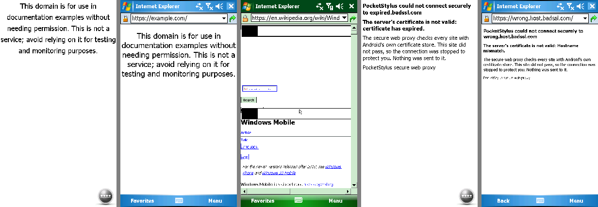
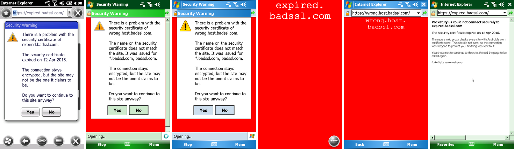

# Secure web proxy: modern HTTPS for Windows Mobile

Windows Mobile's TLS stack (Schannel) is from 2009. It speaks TLS 1.0 at best, with RSA key exchange and
CBC/RC4 ciphers, sends no SNI and trusts a 2009 root store. Nearly every HTTPS site today refuses that
handshake, and the rest fail certificate validation against the old roots. Before this work, IE Mobile showed
"Cannot find 'https://example.com/'" (6.1.4, 6.5.3) or "The Web site cannot be authenticated" (WM 5.0).

PocketStylus now terminates the guest's TLS inside the app and opens a modern TLS connection to the real
site itself. The guest trusts a private root CA that the app creates and the helper installs into WM's root
store.

Tags as in the other research docs: **[MEASURED]** = seen in the CLI on the phone, **[DOC]** = Microsoft
documentation, **[INFERRED]** = reasoning not checked directly.



*Left to right: example.com on 6.5.3 and WM 5.0, Wikipedia on 6.1.4 (padlock, no warning), then the
proxy's error pages for expired.badssl.com (6.5.3) and wrong.host.badssl.com (WM 5.0).*

---

## 1. What the guests send [MEASURED]

These ClientHellos were captured in `usernet` from IE Mobile opening `https://example.com/` on cold-booted
images:

| Release | Record | Hello version | Cipher suites, in client order | Extensions |
|---|---|---|---|---|
| 6.5.3 (`fwvga.bin`) | TLS record 3.0 | TLS 1.0 | `002f` AES128-SHA, `0035` AES256-SHA, `0004` RC4-MD5, `0005` RC4-SHA, `000a` DES-CBC3-SHA, `0009` DES-CBC-SHA, `0064`/`0062` EXP1024 RC4/DES, `0003`/`0006` EXP RC4/RC2-40 | **none** (no SNI, no renegotiation_info) |
| 6.1.4 (`wm614wvga.bin`) | same bytes as 6.5.3 | TLS 1.0 | same list | none |
| 5.0 (`wm5gsmvga.bin`) | **SSL 2.0-framed** (V2ClientHello, `80 43 01 03 01`) | TLS 1.0 | `000004` RC4-MD5, `000005` RC4-SHA, `00000a` DES-CBC3-SHA, then SSL 2 specs (`010080`, `0700c0`, `030080`, `060040`, `020080`, `040080`) and DES/export suites. **No AES.** | n/a (V2 format has none) |

What this means:

- There is no SNI, so the proxy can't learn the host from the handshake (§3).
- WM 6.x can use TLS_RSA_WITH_AES_128_CBC_SHA. WM 5.0's best suite is TLS_RSA_WITH_3DES_EDE_CBC_SHA.
- The server side must accept a V2ClientHello (WM 5.0) and RSA key exchange (all releases).
- [MEASURED] All three accept a 2048-bit RSA leaf signed with SHA-1 by a 2048-bit root.
- [MEASURED] All three honour subjectAltName DNS entries: IE showed "valid name matching" for a certificate
  whose CN was a different name. SHA-256 signatures were not tried, because WM 5.0's crypt32 is the weakest
  link and SHA-1 works everywhere.

## 2. Design decisions

### TLS library: BoringSSL, prebuilt in `third_party/boringssl`

- Both legs need one library: an old-protocol **server** (TLS 1.0, V2ClientHello, RSA kex, AES-CBC/3DES) and a
  modern **client** (TLS 1.2/1.3, hostname checks).
- BoringSSL still parses V2ClientHello, still has `TLS_RSA_WITH_3DES_EDE_CBC_SHA` (when named explicitly)
  and AES-CBC-SHA, and allows TLS 1.0 as a minimum. It also has TLS 1.3 and is actively maintained.
- Its CMake build needs neither Go nor Perl, because the generated sources ship in the tree. The Android
  SDK's CMake/Ninja and the NDK build it on Windows in about 2.5 minutes per ABI.
- OpenSSL 3 would also work and keeps RC4 and SSL 3. But it needs Perl and make for an Android
  cross-build, and RC4 isn't needed: every guest offers AES or 3DES.
- mbedTLS 2.28 has TLS 1.0 but no TLS 1.3, and it is end-of-life. mbedTLS 3 has no TLS 1.0.
- Doing the TLS in Kotlin (Conscrypt `SSLEngine`) was rejected. Conscrypt no longer offers TLS 1.0, 3DES or
  V2ClientHello server-side reliably. It also isn't available to the headless CLI, which has to run the
  proxy too.
- `tools/build-boringssl.sh` clones tag **0.20260903.0** (commit `0ce57bbf…`) and builds `libssl.a` +
  `libcrypto.a` for arm64-v8a and x86_64 (API 26, `-fvisibility=hidden`, debug info stripped: about
  6.6 MB per ABI). It copies the headers and licence into `third_party/boringssl` (`VERSION` records tag,
  commit and NDK).
- `core/CMakeLists.txt` and `tools/build-cli.sh` link the libraries when they exist for the ABI and define
  `WM_HAVE_TLS`. Without them the proxy compiles to a stub and HTTPS passes through unchanged.

### Interception in usernet, not a Connection Manager proxy setting

- `UserNet` already re-originates every guest TCP connection, so interception is one branch in the SYN
  handler (`usernet.cpp`, `handleTcp`). For a destination port in the proxy's list (default 443), and any
  address but the gateway, the connection's host socket becomes one end of a `socketpair`. `TlsProxy::serve`
  gets the other end and runs the connection on its own thread.
- Everything else in usernet stays the same: TCP state, windows, retransmits.
- An explicit proxy in Connection Manager would only cover programs that use WinInet and ConnMgr's proxy,
  and it would need `CONNECT` handling plus per-release provisioning. Interception covers every program,
  including ones with their own sockets.

### Learning the host name without SNI

The proxy uses three sources of names:

1. **DNS memory.**
   - usernet's DNS remembers which names resolved to which address (`rememberName`: up to 16 names per
     address, kept 6 h, names limited to `[A-Za-z0-9._-]`).
   - The leaf certificate carries **all** names recently resolved to the connected address as
     subjectAltNames, newest name as CN, plus the address as an IP SAN.
   - So the guest's name check passes even when several sites share an address (CDNs). [MEASURED]
     `en.wikipedia.org`, `en.m.wikipedia.org` and `thumb.wikimedia.org` all came from 208.80.154.224.
2. **The HTTP request's `Host` header.**
   - After the guest's handshake, the proxy reads the request head (up to 16 KB).
   - It connects upstream to the `Host` name, uses it as SNI and validates the certificate against it.
   - If the name is one of the address's DNS names, the proxy connects to the address the guest chose;
     otherwise it resolves the name.
   - If the stream isn't HTTP (no header within 3 s), it falls back to SNI, then the newest DNS name, then the
     address.
3. **SNI.** If a guest ever sends one, it goes first in the certificate.

The memory is saved to `names.txt` next to the CA: every 30 s when it has changed, and when usernet stops. A
restored session whose guest still caches a DNS answer from before therefore keeps its names. Without this,
IE warned "The name on the certificate is not valid" [MEASURED].

### Certificates

- **Root CA.** RSA-2048, made on first use with `EVP_RSA_gen`, self-signed with SHA-1.
  - Subject: `CN=PocketStylus Secure Web Proxy CA <4 random hex>, O=PocketStylus (private to this phone)`.
  - basicConstraints critical `CA:TRUE, pathlen:0`; keyUsage critical keyCertSign+cRLSign; SKI.
  - Validity 2000-01-01 to 2049-12-31 (UTCTime).
  - Files: `ca.key` and `leaf.key` (PEM PKCS#8), and `ca.cer` (DER). All are written with mode 0600, via
    temp file and rename.
  - The app keeps them in `noBackupFilesDir/tls`. The manifest also has `allowBackup="false"`.
- **Leaf.** One RSA-2048 key per CA (`leaf.key`, generated once) with certificates minted per name set and
  cached in memory (up to 256).
  - Serial: random 128-bit.
  - Validity: 2000-01-01 to now + 397 days. The early start tolerates a guest clock that hasn't been synced
    yet; the CA is private, so nothing else checks it.
  - basicConstraints CA:FALSE; keyUsage critical digitalSignature+keyEncipherment; EKU serverAuth; SAN;
    AKI keyid.
  - Signed with SHA-1.

### Guest-facing TLS (`server` context)

- Protocols TLS 1.0 to 1.2. Server cipher preference:
  `ECDHE-RSA-AES128-GCM-SHA256:ECDHE-RSA-AES256-GCM-SHA384:ECDHE-RSA-AES128-SHA:ECDHE-RSA-AES256-SHA:AES128-SHA:AES256-SHA:DES-CBC3-SHA`.
- [MEASURED] WM 6.1.4 and 6.5.3 negotiate `TLSv1 AES128-SHA`; WM 5.0 negotiates `TLSv1 DES-CBC3-SHA`.
- RC4 and the export suites are never chosen.

### Upstream TLS (`client` context)

- TLS 1.2 minimum (1.3 preferred), BoringSSL's default suites, ALPN `http/1.1` (the guest speaks HTTP/1.x).
- SNI and hostname verification (`SSL_set1_host`) use the upstream name; IP literals are checked with
  `X509_VERIFY_PARAM_set1_ip_asc`.
- **Trust store:** Android's system store, read natively from `/apex/com.android.conscrypt/cacerts` (Android
  14+, the updatable Conscrypt store), else `/system/etc/security/cacerts`. That is 120 roots on the Fold7
  [MEASURED].
  - This is the same set the default `TrustManager` of a targetSdk ≥ 24 app trusts.
  - User-added CAs are not trusted, which matches Android's default for apps.
  - Native loading keeps the CLI and the app identical and avoids a JNI round trip per handshake.
- Relay: two non-blocking SSL objects with `poll`, one buffer per direction, and backpressure (a side is
  read only while its buffer is empty). A connection closes after 10 idle minutes or when either side ends.

### Failures: error page, or "continue anyway" for certificate problems

- If the upstream can't be reached, or its TLS handshake fails (no common protocol or suite, a reset), the
  proxy completes the guest's handshake and answers the request with an HTTP 502 page. The page names the
  host and the reason and says nothing was sent to the site.
- No request bytes go upstream before the upstream handshake has succeeded **and** its certificate either
  passed or is one the user accepted (below).
- IE Mobile 6 (6.5.3) replaced the first, shorter page with its own "friendly" *Error 502 - Bad Gateway*.
  The page is now padded past 1.5 KB, after which IE showed it [MEASURED].

### Certificate warnings: "Do you want to continue to this site anyway?"

When only the **certificate** fails (expired, wrong name, untrusted or self-signed issuer), the proxy asks
the user instead of failing at once, the way a desktop browser's warning page does.



*Left to right: the question for expired.badssl.com (6.5.3) and wrong.host.badssl.com (6.1.4, 5.0); after
Yes, expired.badssl.com (6.5.3) and wrong.host.badssl.com (5.0) load in the same request; after No, the
error page (6.1.4).*

How it runs:

1. **Check.** The upstream `SSL_CTX` has a verify callback (`Impl::verifyCb`). It records every
   problem of the chain (one sentence each, `describeProblem`), the leaf's SHA-256 fingerprint and names,
   and returns 1 so the handshake finishes and the question can list *all* problems. `run()` then sends
   nothing on that connection unless the check was clean or the fingerprint is one the user accepted for
   this host; a failed one is shut down at once.
2. **Question.** `Impl::ask` keeps the guest's request waiting (the request head is already read and held)
   and queues a question: id, host, text, deadline. **One question per host at a time**: other connections to
   the same host (IE opens several) wait on the same question. A host the user just declined gets no new
   question for 3 s, so parallel connections can't start a prompt storm.
3. **Delivery.** Core → app → helper, polled like the other core events:
   - `TlsProxy::takePrompts()` (JNI `NativeBridge.tlsPrompts`) hands out new questions as
     `"<id> <seconds> <host>\n<message>"`. `SecureProxy.tick` calls it every second from
     `EmulatorActivity`'s tick and sends each as the mailbox command `tlsask <id> <seconds> <host>\n<message>`.
   - The helper (`guest/Helper/TlsAsk.cs`) shows a native `MessageBoxW`: caption **Security Warning**,
     Yes / No with **No as the default**, `MB_ICONEXCLAMATION | MB_SETFOREGROUND | MB_TOPMOST`. It runs on
     its own thread, one box at a time, so the mailbox loop and its watchdog keep going.
   - The answer comes back as `tlsask <id> yes|no|timeout` → `SecureProxy.onGuest` →
     `NativeBridge.tlsAnswer` → `TlsProxy::answerPrompt`.
4. **Yes.** The pair (host, leaf SHA-256) is allowed **for this session, in memory only**
   (`SecureProxy.attach` calls `tlsForget` for every new session; nothing is written to disk). The waiting
   connection connects again and proceeds only if the server shows that same certificate; the held request
   then goes upstream and **the page loads without a reload**. The upstream leg is unchanged: TLS ≥ 1.2,
   SNI, modern suites, still encrypted. Only the certificate problems of that one certificate are excused.
   A server that shows a different certificate on the new connection gets the error page ("showed a
   different certificate from the one you accepted").
5. **No / no answer.** The usual error page, with a note: "You chose not to continue to this site" or
   "got no answer in time", plus "Reload the page to be asked again." A late Yes (after the request
   stopped waiting) still allows the certificate, so a reload then goes straight through.

The message (built in the core, so the app and the CLI show the same thing), worded after Internet
Explorer's own certificate warnings:

```
There is a problem with the security certificate of expired.badssl.com.

The security certificate expired on 12 Apr 2015.

The connection stays encrypted, but the site may not be the one it claims to be.

Do you want to continue to this site anyway?
```

| Problem (X509_V_ERR_…) | Sentence |
|---|---|
| `CERT_HAS_EXPIRED` | The security certificate expired on *d Mon yyyy*. (Intermediate: "A certificate it depends on (*CN*) expired on …") |
| `CERT_NOT_YET_VALID` | The security certificate is not valid until *date*. |
| `HOSTNAME_MISMATCH`, `IP_ADDRESS_MISMATCH` | The name on the security certificate does not match the site. It was issued for *names* (up to 4, "and N more"). |
| `DEPTH_ZERO_SELF_SIGNED_CERT` | The security certificate is self-signed: no trusted authority vouches for it. |
| `SELF_SIGNED_CERT_IN_CHAIN`, `UNABLE_TO_GET_ISSUER_CERT(_LOCALLY)`, `UNABLE_TO_VERIFY_LEAF_SIGNATURE` | The security certificate was issued by a company that is not trusted (*issuer CN*). |
| anything else | The security certificate is not valid: *BoringSSL's text*. |

Dates are UTC as "12 Apr 2015" (no M/D vs D/M ambiguity). Text taken from the certificate is cut to
printable ASCII, 64 characters per item, before it reaches the dialog or the mailbox.

**Timing.** IE Mobile gives up on a request that gets no response:

| Release | IE gave up after [MEASURED: question left open, `--tls-wait 300`] |
|---|---|
| 6.5.3 | 60 s |
| 6.1.4 | 61 s |
| 5.0 | still waiting after 170 s (no timeout seen) |

(6.x: WinInet's 60 s receive timeout.) The proxy waits **40 s** (`TlsProxy::kPromptWaitSec`) and the dialog closes
itself at the same deadline (the helper presses No for the user and answers `timeout`), so the error page
always arrives before IE's own timeout page. If the guest closes the connection first, the proxy stops
holding it (logged as `the guest gave up after N s`).

**No helper, no wait.** The question is only asked when someone answers:

- In the core: nobody has polled `takePrompts()` for 5 s (app in the background, proxy off, CLI without
  `--tls-ask`) → the error page at once, with "PocketStylus could not ask whether to continue anyway: its
  helper is not running in Windows Mobile."
- In the app: `GuestBridge.helperResponsive()` is false (no hello from a current helper this session, or a
  mailbox command waiting over 10 s) → `SecureProxy` declines the question at once, and any questions
  already sent to a helper that then stopped are declined too.

### Setting: "Secure Web Proxy (modern HTTPS)", page Network, **on by default**

Reasons for on by default:

- Without it HTTPS from WM is essentially broken: TLS 1.0 handshakes are refused, and certificate warnings
  come from the 2009 roots.
- With it, each site is checked against Android's current roots with modern TLS, which is stricter and
  safer than WM's own check.
- The weak legacy TLS only exists between two ends inside the same app process (a `socketpair`). It never
  touches a network.
- What it costs: a private root in WM's store, and the app seeing the guest's plaintext. This happens in the
  user's own app on the user's own phone, the same trust the emulator already has (it sees all guest
  memory).

How it applies:

- Live, no restart. `EmulatorActivity.applyLiveSettings` calls `SecureProxy.apply`. New connections follow
  the setting; open ones keep what they had.
- Turning it off also sends `tlsca remove`, so a guest that no longer goes through the proxy doesn't keep
  trusting its root.

## 3. CA installation in the guest [MEASURED on all three releases]

`guest/Helper/TlsCa.cs`, mailbox commands:

| Command | Effect |
|---|---|
| `tlsca install <SHA1>` | Adds `\Storage Card\.wmdroid\pocketstylus-ca.cer` to the root store unless it is there. Removes other `PocketStylus Secure Web Proxy CA*` roots first (a reinstall makes a new CA). |
| `tlsca remove [SHA1]` | Removes the PocketStylus root(s). |
| `tlsca status <SHA1>` | `present` / `absent`, plus ` reg` when the registry key exists. |

- The first method is the **CertificateStore configuration service provider** through `DMProcessConfigXML`:
  `<characteristic type="CertificateStore"><characteristic type="ROOT"><characteristic type="<SHA1>"><parm name="EncodedCertificate" value="<base64 DER>"/>`.
  Removal uses `<nocharacteristic type="<SHA1>"/>`. [DOC: CertificateStore CSP, WM 5/6]
- The fallback is crypt32: `CertOpenStore(CERT_STORE_PROV_SYSTEM_W, …, CERT_SYSTEM_STORE_LOCAL_MACHINE, "Root")`
  and `CertAddEncodedCertificateToStore(…, CERT_STORE_ADD_REPLACE_EXISTING)`. Deletion falls back to
  `CertFindCertificateInStore(CERT_FIND_SHA1_HASH)` + `CertDeleteCertificateFromStore`.
- Presence is checked both through crypt32 (find by SHA-1 in the LOCAL_MACHINE Root store) and through the
  registry key `HKLM\Comm\Security\SystemCertificates\Root\Certificates\<SHA1>`.
- Results seen, identical on 5.0, 6.1.4 and 6.5.3:
  - `tlsca installed csp reg`: the CSP returned `hr=0x00000000` and both checks found the root.
  - Then `tlsca status` → `present reg`.
  - After `tlsca remove` → `tlsca removed 1`, then `tlsca absent`. IE then warned only "issued by a company
    you have not chosen to trust", with the name valid.
- The CSP alone was enough on all three; the crypt32 fallback is there for images whose security policy
  refuses the CSP.
- IE picked up the new root without a restart.
- App side (`SecureProxy.kt`):
  - Makes or loads the CA on a background thread (`NativeBridge.tlsCa`).
  - Enables the session's proxy (`NativeBridge.setTlsProxy`).
  - Writes the DER into the mailbox and sends `tlsca install <SHA1>` after setup and on every helper hello.
    This is idempotent: an existing root answers `present`.

## 4. Verification (CLI on the phone)

```
# base states: cold boot with --net and the card's helper, IE on https://example.com/, saved at 150 s
./wmcore-cli fwvga.bin --mem 192 --screen 480x854 --net --tls tls/ca --load-state … --share test/card \
  --overlay 2577=<card with the new helper> --overlay .wmdroid=<box> --put "2:<box>/in/1.cmd:update" \
  --put "25:<box>/in/2.cmd:tlsca install <SHA1>" --put "36:<box>/in/3.cmd:run \Windows\iexplore.exe https://…"
```

(`wm614wvga.bin --mem 192`, `wm5gsmvga.bin --mem 128` the same.) Results:

| Test | 6.5.3 | 6.1.4 | 5.0 |
|---|---|---|---|
| Before (no proxy) | Cannot find | Cannot find | Cannot be authenticated |
| Proxy on, root not installed | certificate warning (untrusted issuer, name mismatch from a cached DNS answer) | same | same |
| Root installed, `https://example.com/` | loads, no warning | loads, padlock | loads, padlock |
| `https://en.m.wikipedia.org/wiki/…` (redirects to en.wikipedia.org; wikimedia CDN) | loads | loads | loads |
| `https://expired.badssl.com/` | "Security Warning": "The security certificate expired on 12 Apr 2015." | same | same |
| `https://wrong.host.badssl.com/` | "Security Warning": "…does not match the site. It was issued for *.badssl.com, badssl.com." | same | same |
| … answered **Yes** (tap) | the page loads in the same request, upstream TLSv1.2 ECDHE-RSA-AES128-GCM | same | same |
| … the same site again in that session | loads, no question (`certificate problem accepted by the user`) | same | same |
| … answered **No** (tap) | error page + "You chose not to continue to this site. Reload the page to be asked again." | same | same |
| … opened again after No | asked again | same | same |
| … no answer | the box closes itself at 40 s; error page + "got no answer in time" | same | same |
| … nobody polls (`--tls-ask` left out: like the app without a helper) | error page at once + "its helper is not running" | — | — |
| Guest / upstream suites | TLSv1 AES128-SHA / TLSv1.3 AES_128_GCM | same | TLSv1 DES-CBC3-SHA / TLSv1.3 |

The certificate-warning runs started from a state with the root installed, sent `update` (the helper with
`TlsAsk.cs` from the card) and opened the badssl pages with `--tls-ask --box <box>`; Yes / No were `--tap`s
on the box's buttons.

- New CLI options:
  - `--tls DIR`: the proxy with its CA in DIR; prints the thumbprint, and DIR/ca.cer is the root.
  - `--tls-ports 443,…`
  - `--tls-roots DIR`: a PEM folder instead of Android's store, e.g. an empty one to see every upstream fail.
  - `--host-map NAME=TARGET`
  - `--tls-ask` (with `--box`): the app's part for certificate warnings. Polls the questions, sends them as
    `tlsask` commands and passes the helper's `tlsask <id> …` answers back.
  - `--tls-answer yes|no`: answers every question at once, without the helper (core-only tests).
  - `--tls-wait S`: how long a request waits for the answer (default 40).
- The proxy logs one line per connection: `tls: <ip>:443 <host>, guest <proto> <suite>, server <proto> <suite>`
  (plus `, certificate problem accepted by the user`). Refusals log as `upstream rejected: <reason>`;
  questions as `asking whether to continue (#n, up to 40 s)`, `the user chose …`, `no answer to #n` and
  `the guest gave up after N s`.
- Not tested:
  - Opera Mobile: none of the three DE images ships Opera. Another browser would go through the same path.
  - The full restore case for `names.txt`. The file is written and reloaded: later runs logged
    `net: 6 remembered DNS names`. But a restore while the guest still caches an old answer wasn't
    reproduced.
  - The app path (`SecureProxy.kt` plus a real session). The APK builds, but it wasn't installed, so as not
    to disturb the user's running session. This includes the certificate-warning forwarding
    (`SecureProxy.tick` / `onGuest`, `helperResponsive`); the CLI's `--tls-ask` does the same steps.
  - Several connections waiting on one question: IE Mobile opened one connection per page in these tests,
    so the sharing (and the 3 s quiet time after a No) ran only in the code path, not with a real burst.

## 5. Security considerations

- **The CA key** is the sensitive item. With it, anyone could impersonate any site *to this WM guest*, and
  only when they also carry the guest's traffic.
  - It lives in the app's no-backup private storage (0600) and is never exported.
  - Only the certificate goes to the guest (mailbox file, `tlsca install`).
  - Every install makes its own CA; nothing is shared between devices.
  - Turning the proxy off removes the root from WM. Each install removes earlier PocketStylus roots.
- **WM itself trusts the root fully.** WM's crypt32 doesn't honour name constraints [INFERRED], so the root
  can't be limited to "sites via the proxy". This is acceptable because WM's network traffic all flows
  through the app's own NAT.
- **SHA-1 signatures.** These are needed by the guests' certificate code. Chosen-prefix collisions would need
  an attacker to predict the bytes the CA signs; the 128-bit random serial at the front of every TBS makes
  that infeasible. The CA only signs certificates that the proxy itself builds from DNS-learned, character-
  filtered names.
- **Legacy TLS on the guest leg** (TLS 1.0, CBC, 3DES) is only ever inside the process. Its known weaknesses
  (BEAST, Lucky13, Sweet32) need an on-path network attacker and large traffic volume; there is no network
  path here.
- **Upstream validation.** Android's current roots, TLS ≥ 1.2, and hostname or IP checks. Connection and
  TLS failures stop the connection with an error page and no override.
  - No revocation checking (OCSP/CRL), like most Android apps' defaults.
  - User-installed CAs are not trusted.
- **"Continue anyway" for certificate problems** (§2). What limits it:
  - Only the user can allow a certificate: the question shows in WM and only the helper's answer to that
    question id counts. Nothing on the network or in a web page can answer it. The default button is No; no
    answer is No.
  - The exception is the pair (host, SHA-256 of that exact leaf certificate), not the host. A different
    certificate for the same host, e.g. a second attacker, is asked about again.
  - It lasts for the session, in memory: never written to disk, and every new session starts empty
    (`SecureProxy.attach` → `tlsForget`). There is no "remember".
  - Nothing is sent to an unverified server before the Yes. The check runs to the end of the handshake only
    so that the question can list every problem; the connection is then closed unused, and a new one is
    opened after the Yes.
  - Protocol strength is not negotiable: TLS ≥ 1.2 and BoringSSL's default suites apply with or without an
    exception.
  - The text in the dialog comes from the server's certificate (names, issuer): cut to printable ASCII,
    64 characters per item, so a certificate can't break the mailbox command or fill the dialog.
  - Limits: there is no HSTS list, so unlike a desktop browser the question also appears for HSTS sites.
    After Yes, IE still shows its padlock: the guest only ever sees the proxy's valid certificate, so nothing
    in IE marks the page as having had a certificate error.
- **Privacy.** `names.txt` (hostnames the guest resolved in the last 6 h) is stored in app-private storage
  next to the CA. The proxy logs host names to logcat, as usernet's other logs do.
- **Plain HTTP and other ports are not affected.** The proxy is not a general MITM: only the listed TLS ports
  go through it, and the gateway address (the phone's own services) is excluded.

## 6. Future: Escargot (MSN / Windows Live Messenger) and other revived services

The DNS remap hook is in place. Its first rule set, Escargot, is now implemented. See
[research-escargot.md](research-escargot.md): `core/src/net/revival.h`, `HostRule::http`, the setting
"Windows Live Messenger via Escargot" and CLI `--escargot`. The plan below is kept for reference.

- `UserNet::setHostRules(std::vector<HostRule>)` installs the rules; the CLI uses `--host-map name=target`.
- A rule's pattern is either an exact name or `.domain` (the domain and every name under it).
- A rule's target is either an IPv4 literal (answered as is) or a host name (resolved instead).
- The DNS answer the guest sees is the target's address, and the DNS memory records the **original** name.
- So the proxy mints a certificate for the name the guest asked for, connects to the rule's target, and
  validates the upstream certificate against the target name. For an IP target, it validates against the
  original name.

For Escargot, the remaining work:

1. Ship a rule set: Messenger hosts such as `messenger.hotmail.com`, `.msn.com` login and nexus hosts, and
   `.live.com` Passport/RST endpoints → Escargot's servers, following the project's published host list.
2. Map those rules from the app (a setting) to `setHostRules` through a JNI call next to `setTlsProxy`.
3. Decide per endpoint whether upstream is TLS. The Passport/RST endpoints are HTTPS and go through the proxy
   on 443. MSNP itself is plain TCP 1863 and is covered by the DNS remap alone.
4. If Escargot serves an endpoint with a certificate that doesn't match the target name, add a per-rule
   "expected certificate name" field to `HostRule`. Never fall back to skipping validation.

## Files

- `core/src/net/tlsproxy.{h,cpp}`: proxy, CA and leaf minting, trust store, relay, error page, `HostRule`;
  certificate warnings (`verifyCb`, `ask`, `takePrompts` / `answerPrompt` / `clearExceptions`).
- `guest/Helper/TlsAsk.cs` (+ `tlsask` verb in `Helper.cs`): the "Security Warning" box.
- `app/.../SecureProxy.kt` (`tick`, `onGuest`), `GuestBridge` (`tlsask` lines, `helperResponsive`),
  `NativeBridge.tlsPrompts` / `tlsAnswer` / `tlsForget`, `jni.cpp`. CLI: `--tls-ask`, `--tls-answer`,
  `--tls-wait`.
- `core/src/net/usernet.{h,cpp}`: interception (`setTlsProxy`), DNS name memory + `names.txt`, DNS remap
  (`setHostRules`).
- `core/cli/main.cpp`: `--tls`, `--tls-ports`, `--tls-roots`, `--host-map`.
- `core/CMakeLists.txt`, `tools/build-cli.sh`: link BoringSSL. `tools/build-boringssl.sh`, `third_party/boringssl/`.
- `app/src/main/cpp/jni.cpp`: `NativeBridge.tlsCa` / `setTlsProxy`.
- `app/.../SecureProxy.kt`, `Settings.secureProxy`, `GuestSettings` (Network page), `EmulatorActivity` hooks,
  `NativeBridge`.
- `guest/Helper/TlsCa.cs` (+ `tlsca` verb in `Helper.cs`); `app/src/main/assets/guest/WMDroid.exe` rebuilt.
